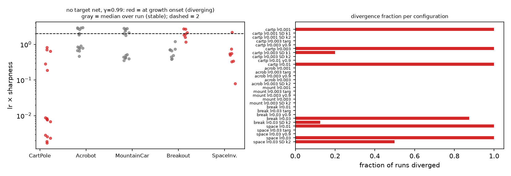

# Off-Policy TD Diverges Along Its Symmetric Spectrum: A Necessary Condition, Two Mechanisms of Deep Divergence, and the Price of Damping

*Conference-length version (RLC format). The full manuscript with all appendices is `paper.md`; every number here is produced by the code in this folder.*

## Abstract

The Jacobian \(K\) of semi-gradient TD's expected update splits into a symmetric part \(S\) and a skew part \(A\). We ask which part is responsible for divergence under the deadly triad, whether the answer gives a usable diagnostic, and what one should change in the update. The first answer is Bendixson's inequality: every eigenvalue of \(K\) has real part at most \(\lambda_{\max}(S)\), so a diverging field must have an unstable symmetric part, and rotation can only hide instability. We confirm this on 900 off-policy linear systems with zero violations and on Baird's counterexample, where deleting \(A\) makes the weights grow *faster*. The second answer is negative: \(\lambda_{\max}(S) > 0\) has a 42% false-positive rate on the linear systems, and an online estimate of it is positive in all 208 measurable deep Q-learning runs across five environments, stable and unstable alike. What does discriminate in the deep case is the learning rate times the sharpness of the TD loss at the moment \(|Q|\) starts to grow: 0.002–0.009 on CartPole, where divergence onset scales as \(1/\mathrm{lr}\) (an outward field; a smaller step delays but never prevents), and 1.9 (range 1.2–2.7) on MinAtar Breakout (overshoot; a third of the step prevents it). Space Invaders shows both in sequence; Acrobot and MountainCar never diverge while sitting at the edge-of-stability value. Three propositions say what damping the positive modes of \(S\) buys for the explicit and implicit step and what it costs: a fixed-point shift \(K_\varepsilon^{-1}Dw^\ast\). SD-TD runs the damping from single transitions with an online Oja tracker at \(O(dk)\) cost; it stops the divergence of TD(0) and ETD(0) on every off-policy linear family we tried, is inactive on-policy, and on Baird-type systems converges to the zero predictor. An anchored variant that damps toward a TDC reference preserves the fixed point and tracks TDC's error to two decimals: the fixed-point-preserving spectral correction exists and buys no speed. The tracker stabilizes 20/20 seeds of a nonlinear Baird network and 19/20 CartPole runs, reduces MinAtar divergence from 7/8 to 1/8 and 8/8 to 4/8, and suppresses the value scale by 10–20× where no divergence was coming.

## 1 Introduction

The deadly triad (Baird, 1995; Tsitsiklis and Van Roy, 1997; Sutton and Barto, 2018) says *when* TD can diverge. Less clear is *which part of the update* is responsible once one is staring at a Jacobian, whether that part can be watched during training, and what to change when one sees it. The semi-gradient field is not a gradient, so its Jacobian \(K\) has a symmetric part \(S\) and a skew part \(A\), and the share \(\|A\|_F^2/\|K\|_F^2\) is a *curl fraction*. A natural guess is that the rotation is the problem. On Baird's counterexample the curl fraction is 0.324 and separates the diverging run from a frozen-target run before any weight has moved.

The guess is wrong in a specific way. Deleting \(A\) on Baird makes the weights grow faster. Across five families of random off-policy systems every diverging system had an unstable symmetric part and none needed its skew part. The reason is Bendixson (1902): \(\operatorname{Re}\lambda(K) \le \lambda_{\max}(S)\). On Baird rotation reduces the growth rate from 1.021 to 0.239, and the iteration diverges anyway.

That inequality reorganizes the question in two directions. *Diagnostic:* \(\lambda_{\max}(S) > 0\) is necessary; is it a useful warning? No, in linear systems (42% false positives) and in deep Q-learning (positive in every one of 208 runs on five environments). What discriminates in the deep case is a different number, \(\mathrm{lr} \times \mathrm{sharpness}\) of the TD loss at the moment \(|Q|\) starts to grow, and it shows that "divergence without a target network" is two phenomena: an outward field on CartPole (product 0.002–0.009 at onset, onset time \(\propto 1/\mathrm{lr}\)) and step-size overshoot on MinAtar Breakout (product 1.9 at onset, prevented by a smaller step), with Space Invaders in between and Acrobot/MountainCar not diverging at all. *Constructive:* if divergence lives in \(S\), damp its positive modes. We say what that buys (Props. 1–2), what it costs (Prop. 3), run it from single transitions (SD-TD), and show that the variant which repairs the fixed point inherits the speed of the convergent method it is anchored to.

**Contributions.** (1) Lemma 1 and Propositions 1–3 with proofs, verified on 900 systems with zero violations. (2) The diagnostic is necessary and not sufficient, in 900 linear systems and 208 deep runs. (3) Two mechanisms of deep divergence separated by one measurement across five environments (210 runs). (4) SD-TD: 16,632 sampled linear runs against TD(0), GTD2, TDC, ETD(0); stops divergence, inactive on-policy, fixed point ≈ zero predictor on Baird-type systems. (5) Anchored SD-TD preserves the fixed point, is stable wherever TDC is, and matches TDC's error within 0.02 everywhere. (6) Transfer: 20/20 nonlinear Baird seeds, 19/20 CartPole, 7/8→1/8 Breakout, 8/8→4/8 Space Invaders, at the cost of the value scale on Acrobot and MountainCar.

## 2 Related work

Tsitsiklis and Van Roy (1997) prove on-policy convergence from the negative definiteness of the symmetric part of the TD Jacobian in the \(d_\mu\) inner product; Kolter (2011) and Bhandari et al. (2018) build on the same condition. Gradient-TD (Sutton et al., 2009) and emphatic TD (Sutton et al., 2016) are the algorithmic answers and our baselines. Zhang et al. (2021) prove a target network with projection breaks the triad for linear Q-learning; Van Hasselt et al. (2018) study it empirically in DQN and name the soft divergence we see on CartPole; Achiam et al. (2019) analyze the full deep Q-learning Jacobian. The edge-of-stability literature (Cohen et al., 2021) studies gradient descent at \(\mathrm{lr} \times \mathrm{sharpness} \approx 2\); we measure that product for TD and find divergence far below it on CartPole, at it on Breakout, and stable training hovering at it on Acrobot and MountainCar. Oja (1982) is the tracker. MinAtar is Young and Tian (2019). Bendixson's inequality is textbook; its use to separate "which half diverges" is, as far as we know, new in this literature.

## 3 Preliminaries

**Linear off-policy TD.** States \(s\), features \(x(s) \in \mathbb R^d\), target \(\pi\), behavior \(\mu\) with stationary \(d_\mu\), \(\rho = \pi/\mu\), discount \(\gamma\). The expected TD(0) update is \(w \leftarrow w + \alpha(Kw + b)\) with \(K = \mathbb E[\rho\, x\,(\gamma x' - x)^\top]\), \(b = \mathbb E[\rho\, r\, x]\). The field \(\dot w = Kw + b\) is stable iff all eigenvalues of \(K\) have negative real part; the explicit step iff \(\rho(I + \alpha K) < 1\). Write \(K = S + A\), \(S = (K + K^\top)/2\). A transition contributes the unbiased estimate \(\hat S = \tfrac12\rho(x\,\delta x^\top + \delta x\,x^\top)\), \(\delta x = \gamma x' - x\). RMSVE is the \(d_\mu\)-weighted RMS value error; we compare to the RMSVE of predicting zero.

**Deep Q-learning.** For semi-gradient on the TD loss with gradient \(g\), the field is \(-g\) and \(K = -Dg\). The largest eigenvalue of \(\operatorname{sym}(Dg)\) is the *sharpness* (step-size stability threshold 2 on a quadratic); its most negative eigenvalue, negated, is \(\lambda_{\max}(S)\) of the field. Both are estimated by power iteration with Jacobian-vector products on a replay batch.

## 4 The symmetric part bounds the field

**Lemma 1 (Bendixson).** For real square \(K\), \(\max_i \operatorname{Re}\lambda_i(K) \le \lambda_{\max}(S)\).
*Proof.* For \(Kv = \lambda v\), \(\|v\| = 1\): \(\lambda = v^*Sv + v^*Av\), and \(v^*Av\) is purely imaginary for skew real \(A\), so \(\operatorname{Re}\lambda = v^*Sv \le \lambda_{\max}(S)\). \(\square\)

So an unstable field has an unstable symmetric part, and no operation on \(A\) alone can stabilize one: for any skew \(A'\), \(u^\top(S + A')u = u^\top S u > 0\) at the top eigenvector of \(S\). On Baird, \(\lambda_{\max}(S) = 1.021\) and the largest real part of \(K\) is 0.239.

**Damping.** With eigenpairs \((\lambda_i, u_i)\) of \(S\) and \(\varepsilon > 0\), let \(D = \sum_{\lambda_i > 0}(\lambda_i + \varepsilon)u_iu_i^\top\), \(K_\varepsilon = K - D\), \(S_\varepsilon = S - D\), and \(\varepsilon' = -\lambda_{\max}(S_\varepsilon) > 0\).

**Proposition 1 (explicit step).** \(\|I + \alpha K_\varepsilon\|_2^2 \le 1 - 2\alpha\varepsilon' + \alpha^2\|K_\varepsilon\|_2^2\); a strict contraction for \(\alpha < 2\varepsilon'/\|K_\varepsilon\|_2^2\).
*Proof.* \(\|(I + \alpha K_\varepsilon)v\|^2 = 1 + 2\alpha v^\top S_\varepsilon v + \alpha^2\|K_\varepsilon v\|^2\) since \(v^\top A v = 0\). \(\square\)

**Proposition 2 (implicit step).** For every \(\alpha > 0\), \(\|(I - \alpha K_\varepsilon)^{-1}\|_2 \le (1 + 2\alpha\varepsilon')^{-1/2} < 1\).
*Proof.* \(\|(I - \alpha K_\varepsilon)v\|^2 = 1 - 2\alpha v^\top S_\varepsilon v + \alpha^2\|K_\varepsilon v\|^2 \ge 1 + 2\alpha\varepsilon'\). \(\square\)

**Proposition 3 (fixed-point shift).** If \(K, K_\varepsilon\) are invertible, \(w^\ast = -K^{-1}b\), \(w_\varepsilon = -K_\varepsilon^{-1}b\), then \(w_\varepsilon - w^\ast = K_\varepsilon^{-1}Dw^\ast\); the shift vanishes iff \(Dw^\ast = 0\).
*Proof.* Subtract \(K_\varepsilon w_\varepsilon + b = 0\) from \(Kw^\ast + b = 0\). \(\square\)

Propositions 1–2 separate two failure modes of the explicit step that look alike from outside: an outward field (a positive mode of \(S\); damping removes it) and overshoot of a stiff stable direction (the \(\alpha^2\|K_\varepsilon\|^2\) term; a smaller step, a clip, or the implicit step removes it). Proposition 3 is the bill, and it also says what a fixed-point-preserving correction must do: damp \(w - w_{\mathrm{ref}}\) for a reference that itself converges to \(w^\ast\) (Section 7.3).

**Numerical check; necessary, not sufficient.** On 900 systems from five families (Baird structure, random softmax, cycles, self-loops, aliased features): zero Bendixson violations (largest gap \(4 \times 10^{-16}\)), zero violations of Prop. 1 at \(\alpha \in \{0.05, 0.5\}\) and of Prop. 2 at \(\alpha \in \{0.05, 0.5, 5\}\). Of the 900, 440 have \(\lambda_{\max}(S) > 0\) and 254 have a positive real eigenvalue of \(K\): no false negatives, 42% false positives.

## 5 Exact linear fields

**Baird.** Sutton and Barto's construction, \(\gamma = 0.99\), curl fraction 0.324. At \(\alpha = 0.05\), frozen-target TD stays at weight norm 12.7; semi-gradient TD diverges on every seed (final norms 47–60). Subtracting \(A\) at every step, so the field is exactly \(Sw\), still diverges and ends at mean norm 70.7 against 54 for TD. Scaling \(S + \beta A\) over \(\beta \in [0, 1.5]\) moves the largest real part from 1.021 to 0.131 and never makes it negative.

**Five families, \(\alpha = 0.05\).** Baird structure 200 systems, 52 diverge, 52 fixed by damping (\(\varepsilon = 0.05\)), 0 by dropping \(A\), 0 needed \(A\); random kernels 400/15/15/0/0; aliased 200/23/23/0/0; cycles and self-loops 0 diverge. Damping broke none of the 121 stable systems in an earlier draw. From a *sampled* \(K\) (relative error 0.10–0.18) damping its estimated modes fixed 12/12 diverging systems; the top unstable mode is estimated to cosine 0.996–0.999, which motivates tracking the mode rather than the matrix.

**\(\alpha = 0.5\): overshoot.** Baird structure 49 diverge, damping fixes 31, the implicit step on \(K_\varepsilon\) fixes 49; random 25/11/25; cycles 12/0/12; aliased 6/6/6. On every inspected failure the smallest eigenvalue of \(S_\varepsilon\) was below \(-2/\alpha = -4\) (medians \(-6.16\), \(-4.95\), \(-5.04\)); clipping it into \((-2/\alpha + \varepsilon, -\varepsilon)\) fixed 9/9, 10/10, 3/5. Two failure modes, two remedies, no system saved by editing \(A\) alone.

## 6 Deep Q-learning without a target network: two mechanisms, five environments

**Setup.** A SiLU Q-network (two hidden layers of 64) trained by plain SGD on the semi-gradient TD loss from a replay buffer (batch 64), \(\varepsilon\)-greedy 1.0 → 0.05 over 5,000 of 10,000 steps, bootstrapping from the online weights. Controls: Polyak target network (\(\tau = 0.005\)) and the same no-target run at \(\gamma = 0.9\). Environments: CartPole-v1 (lr \(10^{-3}, 3 \times 10^{-3}, 10^{-2}\); 5 seeds, 10 configurations), Acrobot-v1 and MountainCar-v0 (lr \(10^{-3}, 3 \times 10^{-3}\); 8 seeds), MinAtar Breakout and Space Invaders (lr \(10^{-2}, 3 \times 10^{-2}\), ten times larger because plain SGD does not move \(|Q|\) off zero at \(10^{-3}\) on sparse rewards and a 400–600-dimensional input; 8 seeds). 210 runs. Every 100 steps on a 256-batch we log mean \(|Q|\), \(\mathrm{lr} \times \mathrm{sharpness}\), the tracked \(\lambda_{\max}(S)\) (shifted deflated power iteration, Section 7.4), and the curl fraction. Divergence: mean \(|Q| > 10^4\) or non-finite weights.

**The question.** Story A: step-size instability, \(\mathrm{lr} \times \mathrm{sharpness} > 2\) (Cohen et al., 2021). Story B: an outward field, \(\lambda_{\max}(S) > 0\), growth at any step. They predict different scalings (A: a smaller step prevents; B: it delays in proportion) and different values of the product *at growth onset*, the first measurement at which \(|Q|\) exceeds three times its first value.

| Environment, configuration (\(\gamma = 0.99\), no target unless marked) | Diverged | Onset step | lr × sharp. at onset, median (range) | lr × sharp., run median | Final \(|Q|\) | Return |
|---|---:|---|---|---:|---:|---:|
| CartPole, lr \(10^{-3}\) / \(3 \times 10^{-3}\) / \(10^{-2}\) | 5/5, 5/5, 5/5 | 4,600–5,300 / 1,500–1,700 / 500–700 | 0.002 / 0.008 / 0.64 (0.19–0.82) | 0.05 / 0.17 / 0.42 | — | — |
| CartPole, target net / \(\gamma = 0.9\) | 0/5, 0/5 | — | — | 0.13 / 0.06 | 35 / 10 | 390 / 478 |
| Acrobot, lr \(10^{-3}\) / \(3 \times 10^{-3}\) | 0/8, 0/8 | — | — | 0.78 / 2.69 | 88 / 82 | −485 / −500 |
| Acrobot, target net / \(\gamma = 0.9\) | 0/8, 0/8 | — | — | 0.31 / 0.15 | 31 / 10 | −212 / −498 |
| MountainCar, lr \(10^{-3}\) / \(3 \times 10^{-3}\) | 0/8, 0/8 | — | — | 0.42 / 2.50 | 86 / 86 | −200 |
| MountainCar, target net / \(\gamma = 0.9\) | 0/8, 0/8 | — | — | 0.31 / 0.13 | 34 / 10 | −200 |
| Breakout, lr \(10^{-2}\) / \(3 \times 10^{-2}\) | 0/8, **7/8** | — / 1,600–9,800 | — / **1.93 (1.16–2.71)** | 0.57 / 1.11 | 1.8 / — | 2.5 / 0.9 |
| Breakout, target net / \(\gamma = 0.9\) (lr \(3 \times 10^{-2}\)) | 0/8, 0/8 | — | — | 0.61 / 0.92 | 1.5 / 0.6 | 2.4 / 2.2 |
| Space Invaders, lr \(10^{-2}\) / \(3 \times 10^{-2}\) | 8/8, 8/8 | 500–2,000 / 300–400 | 0.52 (0.08–2.17) / n.a. | 0.52 / 1.20 | — | 4.8 |
| Space Invaders, target net / \(\gamma = 0.9\) (lr \(3 \times 10^{-2}\)) | 0/8, 0/8 | — | — | 0.46 / 0.69 | 3.3 / 1.1 | 5.8 / 6.2 |

*Figure 1. Left: \(\mathrm{lr} \times \mathrm{sharpness}\) per run in the no-target \(\gamma = 0.99\) configurations; red at growth onset for diverging runs, gray run-median for stable runs, dashed at 2. Right: divergence fraction per configuration.*

**CartPole: outward field.** \(|Q|\) grows steadily from the first measurement; at lr \(10^{-3}\) by a factor of 100 (0.1 to 14) between steps 300 and 2,400 while the product stays in 0.002–0.06, crossing 1 only in the last 300 steps before NaN. Onset moves 500–700 → 1,500–1,700 → 4,600–5,300 as the step drops \(10^{-2}\) → \(3 \times 10^{-3}\) → \(10^{-3}\): delayed in proportion, never prevented. Story B. The sharpness catches up at the end as a consequence of large weights.

**Breakout: overshoot.** At lr \(3 \times 10^{-2}\), \(|Q|\) sits at 1–3 for thousands of steps with the product oscillating between 1.1 and 2.7, and seven of eight runs end within 100–300 steps of a measurement at 1.2–2.7 (median 1.9; last finite measurement median 2.1). At lr \(10^{-2}\) nothing diverges and the product is 0.57. Story A: a third of the step prevents it. The target network and \(\gamma = 0.9\) also prevent it, by lowering the sharpness (0.6–0.9) rather than the step.

**Space Invaders: a field that inflates the sharpness.** All runs diverge at both steps. At lr \(10^{-2}\), \(|Q|\) rises from 0.5 to 4–11 over 200–400 steps while the product climbs from 0.1 to 0.5–2.2, and the weights are non-finite 100–200 steps later; the onset median is 0.52 (0.08–2.17). Onset moves by a factor of 1.5–5 for a factor of 3 in step. Both mechanisms in sequence: an outward field inflates \(|Q|\), the sharpness grows with the weights, and the step-size instability finishes the run (CartPole shows the same ending, product 1.5 at the last finite measurement, after a first stage a hundred times longer).

**Acrobot and MountainCar: no divergence, at the edge of stability.** Nothing diverges. Mean \(|Q|\) reaches 82–88, which is the correct scale: both pay \(-1\) per step over 200–500-step episodes and \(-(1 - \gamma^T)/(1 - \gamma) \approx -87\) to \(-99\); the \(\gamma = 0.9\) controls sit at \(|Q| = 10\) for the same reason, and weight norms end at 18.5–19.7 from 16. The target-network runs reach only \(|Q| = 31\)–\(34\) in the budget (slower, not more correct) and have the better Acrobot policy. At lr \(3 \times 10^{-3}\) the product has per-run medians 1.8–2.9 across all 16 runs with no divergence: plain SGD on the TD loss hovering at the edge of stability exactly as on supervised losses.

**The symmetric part is positive, and so is everyone's.** The tracked \(\lambda_{\max}(S)\) is positive at some measurement in every measurable run (50/50 CartPole, 158/158 others; two Space Invaders runs died before the first measurement), and at the first measurement in all but four Breakout runs (first estimate \(-10^{-4}\)). On Acrobot and MountainCar its run median is 1.1–9.5, larger than in the diverging CartPole runs (0.03–1.0), and nothing diverges. The curl fraction is 0.06–0.35 in every condition and separates nothing. A target network does not make the online field's symmetric part stable; it changes which field is followed.

**For a practitioner.** A smaller learning rate shrinks the overshoot term of Proposition 1 and does nothing to the sign of \(\lambda_{\max}(S)\); it fixes Breakout and delays CartPole. A target network or shorter horizon changes the field and fixes both. The product at growth onset costs a few Jacobian-vector products every 100 steps and tells the cases apart.

## 7 SD-TD: damping the symmetric spectrum from samples

### 7.1 Algorithm and linear comparison

SD-TD keeps \(k\) unit vectors \(u_i\) and estimates \(\hat\lambda_i\), updated by a deflated online Oja step on \(\hat S u_i = \tfrac12\rho(x(\delta x^\top u_i) + \delta x(x^\top u_i))\) at rate \(\eta\), then takes \(w \leftarrow w + \alpha(\rho\,\delta\,x - \sum_{\hat\lambda_i > 0}(\hat\lambda_i + \varepsilon)u_i u_i^\top (w - w_{\mathrm{ref}}))\) with \(w_{\mathrm{ref}} = 0\). Cost \(O(dk)\), the order of GTD2/TDC. We fix \(k = 2\), \(\eta = 0.02\), \(\varepsilon = 0.05\) everywhere. If every \(\hat\lambda_i \le 0\) it is exactly TD(0).

Sampled runs on five families (Baird reward 0; five Baird-with-rewards draws; 20 diverging Baird-structure systems; 20 random softmax; 20 on-policy), 20,000 transitions, six seeds, \(\alpha \in \{0.002, \ldots, 0.1\}\), GTD2/TDC with \(\beta = \alpha\) (\(\beta = 10\alpha\) helps TDC on Baird reward 0, 1.15 vs 1.86, and is more divergence-prone elsewhere). Median tail RMSVE at each method's best step, divergence fraction in parentheses:

| Family | TD(0) | GTD2 | TDC | ETD(0) | SD-TD | predict 0 |
|---|---|---|---|---|---|---|
| Baird, reward 0 | div. 100% | 1.91 (0%) | 1.86 (0%) | 330 (67%) | \(10^{-28}\) (0%) | 0 |
| Baird + rewards | div. 100% | 2.65 (0%) | 2.66 (0%) | 553 (33%) | 0.87 (0%) | 0.87 |
| Baird structure | 38.4 (35%) | 0.70 (0%) | 0.75 (0%) | 0.41 (23%) | 0.71 (5%) | ≈ 0.71 |
| Random softmax | 0.305 (0%) | 0.49 (0%) | 0.41 (0%) | 1.17 (31%) | 0.277 (0%) | — |
| On-policy | 0.206 (0%) | 0.225 (0%) | 0.251 (0%) | 0.206 (0%) | 0.206 (0%) | — |

SD-TD stops the divergence TD(0) and ETD(0) suffer (0% at every \(\alpha \le 0.05\) on Baird with rewards, where ETD diverges at every step because of emphasis variance), is inactive on-policy (damped fraction exactly 0 on 55% of runs, \(\le 2.5 \times 10^{-4}\) on the rest; numbers equal TD(0) to three digits), and its off-policy accuracy is the accuracy of the zero predictor. GTD2 and TDC are stable and slow: 20,000 transitions is a budget, not a verdict.

### 7.2 The fixed-point cost

Computing both fixed points for every system: on Baird with rewards and Baird structure the damped fixed point has RMSVE 0.99 times the zero predictor; on the random family seven of eight systems with a positive mode move from exact to 0.86–1.02 times it; on-policy nothing changes. The unstable mode of \(S\) on Baird-type systems is the direction along which the predictor carries value, so \(Dw^\ast\) is large. SD-TD is a stabilizer that converges to a predictor near zero; it beats GTD2/TDC above only because they have not converged.

### 7.3 Preserving the fixed point: the anchored variant

Take \(w_{\mathrm{ref}}\) to be a TDC iterate run on the same transitions (\(\beta = \alpha\)). The joint system is block-triangular: \(w_{\mathrm{ref}}\) is unaffected by \(w\), and \(w\) follows the damped field driven by it. It has \(w^\ast\) as unique equilibrium whenever TDC converges, is stable whenever TDC and \(K_\varepsilon\) are, and is TD(0) on-policy. Fresh draw of systems, three seeds, 20,000 transitions (median tail RMSVE; divergence fraction where nonzero):

| Family | \(\alpha\) | TD(0) | TDC | SD-TD | Anchored |
|---|---:|---|---|---|---|
| Baird, reward 0 | 0.002 / 0.005 / 0.01 / 0.02 | div. | 2.74 / 1.74 / 2.10 / 1.70 | 0.000 | 2.73 / 1.73 / 2.09 / 1.69 |
| Baird + rewards (zero 0.107) | 0.002 / 0.005 / 0.01 / 0.02 | div. | 3.44 / 1.67 / 2.00 / 1.80 | 0.108 | 3.42 / 1.66 / 1.99 / 1.78 |
| Baird structure (zero 0.298) | 0.002 / 0.005 / 0.01 / 0.02 | 1.24 (46%) / 6.64 (62%) / 96 (71%) / div. | 1.04 / 0.89 / 0.74 / 0.54 (50%) | 0.292 / 0.293 / 0.293 / 0.293 | 1.07 / 0.90 / 0.75 / 0.53 (50%) |
| Random softmax (zero 0.255) | 0.002 / 0.005 / 0.01 / 0.02 | 0.264 / 0.219 / 0.173 (38%) / 0.228 (50%) | 0.525 / 0.372 / 0.234 (38%) / 0.680 (67%) | 0.261 / 0.219 / 0.173 (38%) / 0.228 (50%) | 0.298 / 0.232 / 0.173 (38%) / 0.674 (62%) |
| On-policy | 0.002–0.02 | 0.131–0.133 | 0.133–0.269 | 0.131–0.133 | 0.131–0.133 |

The anchored variant is stable wherever TDC is, preserves the fixed point (0.53–1.07 and falling on Baird structure where SD-TD is parked at 0.29), and tracks TDC within 0.02 in every cell; 200,000 transitions on Baird do not separate them (`paper.md`, Appendix F). It is slaved to its reference along the damped modes and is TD(0) elsewhere, so it is TD(0) wherever TD(0) is fine and TDC's answer where it is not, at TDC's speed. Two other candidates, an oblique spectral flip (exact: 100%; the trackable orthogonal version: 0 of 73) and a slow reference copy (joint system stable on 52/52 Baird-structure but 5/15 random and 2/21 aliased systems), fail for the same reason the anchored one works: preserving the fixed point needs a reference that converges to it, and \(S\) alone does not know where it is.

### 7.4 Networks

**Nonlinear Baird (321-parameter SiLU network, 20 seeds, 600 steps).** The unstable field modes are the *most negative* eigenvectors of \(\operatorname{sym}(Dg)\); plain power iteration returns the sharpest (stable) direction, which is why an earlier projection method helped on 0–11 of 20 seeds. A shifted deflated power iteration (iterate on \(\sigma I - \operatorname{sym}(Dg)\)), two warm-started steps per mode per step, tracks the right modes: 20/20 seeds stable at lr 0.01 and 0.05 for \(k \in \{1, 2, 3\}\) against 5/20 uncorrected; median final \(\|\theta\|\) 8.1 (initial 7.8) against 4,000–13,750.

**SD-DQN** adds \((\hat\lambda_i + \varepsilon)u_iu_i^\top\theta\) on the tracked positive modes (\(k = 2\); two extra Jacobian-vector products per mode per step).

| Environment | DQN no target | SD-DQN | Target net | SD-DQN final \(|Q|\) | Return: SD-DQN (target net) |
|---|---:|---:|---:|---:|---|
| CartPole, lr \(10^{-3}\) / \(3 \times 10^{-3}\) | 5/5, 5/5 | 0/5, 0/5 (\(k = 1\): 0/5, 1/5) | — / 0/5 | 18 / 32 | 165 / 217 (390) |
| Acrobot, lr \(3 \times 10^{-3}\) | 0/8 | 0/8 | 0/8 | 4.2 | −494 (−212) |
| MountainCar, lr \(3 \times 10^{-3}\) | 0/8 | 0/8 | 0/8 | 7.1 | −200 (−200) |
| Breakout, lr \(3 \times 10^{-2}\) | 7/8 | 1/8 | 0/8 | 1.5 | 2.3 (2.4) |
| Space Invaders, lr \(3 \times 10^{-2}\) | 8/8 | 4/8 | 0/8 | 2.3 | 3.8 (5.8) |

Where the mechanism is an outward field (CartPole) damping the tracked mode removes the divergence (19/20) at a cost in return (128–217 against 390, seeds 15–359). Where it is overshoot it helps less (Breakout 7/8 → 1/8, Space Invaders 8/8 → 4/8; the product drops to 0.75 and 0.14 but the sharpness is not controlled directly) and a target network helps more. Where no divergence was coming it costs the value scale: Acrobot and MountainCar \(|Q|\) held at 3–15 against the correct 82–88, Acrobot return −494 against −212. The tracked mode is positive throughout (Section 6), so the brake is on throughout, and it brakes the direction along which the network is learning that every step costs \(-1\). This is Proposition 3 for networks, and the reason we present SD-TD as a stabilizer and Section 6 as the contribution.

## 8 Discussion and limitations

The answer to "which half diverges" is a theorem. The sign of the symmetric spectrum is necessary and a poor predictor: 42% false positives on linear systems, positive in every deep run, and positive precisely while a network learns a value scale of \(1/(1 - \gamma)\) from zero, which is why a brake triggered by it costs exactly that. The quantity that discriminates in the deep case does not predict divergence either; it says how a diverging run is diverging and therefore which remedy will work. Damping the positive modes of \(S\) stabilizes every diverging linear system we constructed, runs from samples at TD's cost, transfers to networks, is inactive when not needed, and moves the fixed point by \(K_\varepsilon^{-1}Dw^\ast\); the variant that repairs the fixed point inherits TDC's speed. A sampled method that stabilizes *and accelerates* convergence to the TD fixed point would need better oblique information about \(K\) than TDC's, and we do not have one.

Everything is small: at most eight states, a 321-parameter network, 4,600–43,000-parameter Q-networks with 5–8 seeds and 10,000 steps. Acrobot and MountainCar did not diverge in 10,000 steps; we cannot say they would not in 100,000. MinAtar uses ten times the classic-control step because plain SGD does not move at \(10^{-3}\); Adam would change the sharpness the step sees. Traces are power-iteration estimates on one 256-batch every 100 steps, so Space Invaders at lr \(3 \times 10^{-2}\) (dead in 300–400 steps) has no onset measurement. Mechanism labels are inferences from one product and one scaling law, not from the full Jacobian. SD-TD's three hyperparameters were fixed once; the 20,000-step budget flatters it against GTD2/TDC, which is why the zero predictor is printed beside it; the anchored comparison has three seeds per cell. The claim is that *when* the explicit semi-gradient step diverged, its symmetric part was unstable, damping removed that instability, and what remained was overshoot of a stiff negative eigenvalue.

## 9 Conclusion

Off-policy TD diverges along its symmetric spectrum; the rotation that makes it "not a gradient" is never the cause and sometimes a brake. The sign of that spectrum locates divergence and does not forecast it, in 900 linear systems and 208 deep runs. What distinguishes the ways a deep Q-network diverges is the learning rate times the sharpness of its TD loss at the moment the values start to grow: far below 2 on CartPole, where a smaller step only delays the blow-up, and at 2 on MinAtar Breakout, where a smaller step prevents it. Damping the positive modes stops the divergence, costs the fixed point by an amount given in closed form, and the variant that repairs the fixed point is as fast as the convergent method it borrows from. Both the stabilizer and the measurement are a few Jacobian-vector products away in any implementation.

## References

Achiam, Knight, Abbeel (2019). Towards characterizing divergence in deep Q-learning. arXiv:1903.08894. · Asadi et al. (2023). TD convergence: an optimization perspective. NeurIPS. · Baird (1995). Residual algorithms. ICML. · Bendixson (1902). Sur les racines d'une équation fondamentale. Acta Math. 25. · Bhandari, Russo, Singal (2018). A finite time analysis of TD learning with linear function approximation. COLT. · Cohen et al. (2021). Gradient descent on neural networks typically occurs at the edge of stability. ICLR. · Ghosh, Bellemare (2020). Representations for stable off-policy RL. ICML. · Kolter (2011). The fixed points of off-policy TD. NeurIPS. · Oja (1982). A simplified neuron model as a principal component analyzer. J. Math. Biol. 15. · Sutton, Barto (2018). Reinforcement Learning: An Introduction, 2nd ed. · Sutton et al. (2009). Fast gradient-descent methods for TD learning with linear function approximation. ICML. · Sutton, Mahmood, White (2016). An emphatic approach to off-policy TD learning. JMLR 17. · Tsitsiklis, Van Roy (1997). An analysis of TD learning with function approximation. IEEE TAC 42. · Van Hasselt et al. (2018). Deep reinforcement learning and the deadly triad. arXiv:1812.02648. · Young, Tian (2019). MinAtar. arXiv:1903.03176. · Zhang, Yao, Whiteson (2021). Breaking the deadly triad with a target network. ICML.

*Appendices (proofs and remarks, system generators, per-step-size tables, pre-divergence trajectories, hyperparameters, fixed-point-preserving variants at 200,000 steps) are in `paper.md`.*
