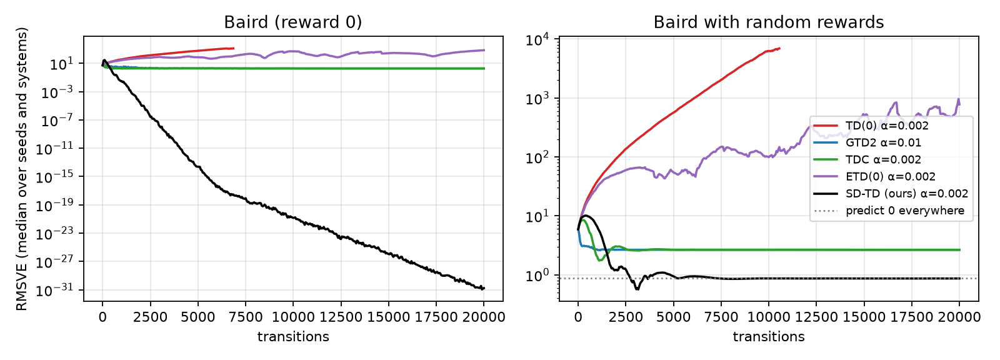
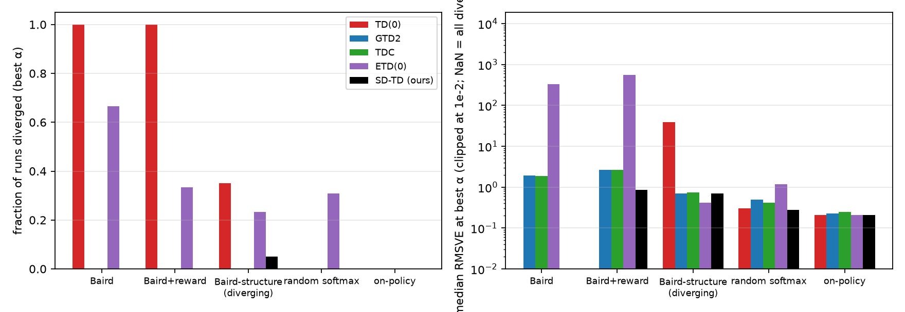
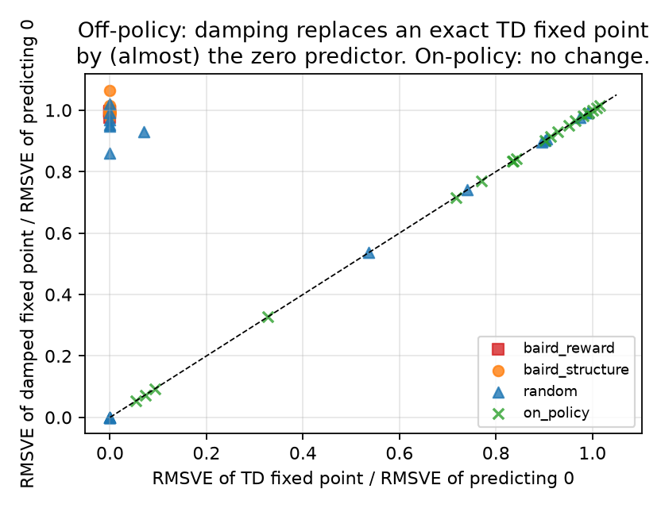
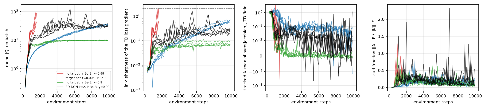
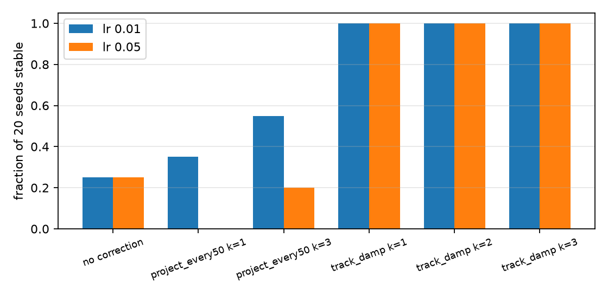

# Off-policy TD diverges along its symmetric spectrum: a necessary condition, a one-line stabilizer, and what the stabilizer costs

**Draft.** Every number below is reproduced by the code in this folder: `n1_td_curl.py` and `probes/push_further.py`, `probes/push_again.py` for the expected-update sweeps (Sections 3–4), and `n1_extensions.py` for the theory checks, the sampled linear comparison against GTD2, TDC and ETD, the nonlinear sweep, and the CartPole runs (Sections 2, 5–7). Figures are made by `make_figures.py`. All systems are small: linear value functions on at most eight states, a 300-parameter network on Baird's features, and a 4,610-parameter DQN on CartPole. Nothing here is Atari or MuJoCo.

## Abstract

Semi-gradient temporal-difference learning is not gradient descent, and its expected update has a Jacobian \(K\) with a symmetric part \(S\) and a skew part \(A\). We ask which part is responsible for divergence under the deadly triad and what to do about it. The answer to the first question is an elementary inequality: the largest real part of any eigenvalue of \(K\) is at most the largest eigenvalue of \(S\), so a diverging field must have an unstable symmetric part, and rotation can only hide instability, never create it. We confirm this on 900 random off-policy systems (zero violations) and on Baird's counterexample, where deleting the skew part makes the weights grow faster, not slower. The converse fails: of 440 systems with \(\lambda_{\max}(S) > 0\), only 254 diverge, and on CartPole the online estimate of \(\lambda_{\max}(S)\) is positive in every run including the stable ones, so the sign of \(S\) is a necessary condition, not a predictor. The constructive half is a stochastic algorithm, SD-TD, that tracks the top \(k\) eigenmodes of \(S\) with an online Oja update from single transitions and damps the positive ones at \(O(dk)\) cost per step. On every off-policy linear family we tried it stops the divergence that TD(0) and ETD(0) suffer, including on Baird's problem with rewards where ETD diverges at every step size and GTD2 and TDC have not converged after 20,000 transitions. It costs nothing on-policy, where it reduces to TD(0). It also has a cost we did not anticipate and report plainly: the damped fixed point is not the TD fixed point, and on Baird-type systems it is nearly the zero predictor, so SD-TD is a brake rather than a corrected learner. The same tracking rule, with the sign convention corrected, stabilizes all 20 seeds of a nonlinear Baird network at two learning rates where the projection in our earlier draft worked on 0–11 of 20, and removes divergence in 19 of 20 CartPole DQN runs trained without a target network. On CartPole the divergence happens while the learning rate times the sharpness of the TD loss is between 0.002 and 0.4, far below the step-size instability threshold of 2, which rules out overshoot and leaves the outward field as the cause.

## 1. The question

The deadly triad is standard: bootstrapping, off-policy sampling, and function approximation can make temporal-difference learning diverge even though the Bellman operator is a contraction (Baird 1995; Tsitsiklis and Van Roy 1997). What is less clear is which part of the update is responsible once you are staring at a Jacobian, and what one should change in the update when one sees it.

The semi-gradient field \(f(w)\) is not a gradient, so its Jacobian \(K = \partial f / \partial w\) splits into a symmetric part \(S = (K + K^\top)/2\) and a skew part \(A = (K - K^\top)/2\). The squared Frobenius share of \(A\), \(\|A\|_F^2 / \|K\|_F^2\), is a curl fraction between 0 and 1. A natural guess is that the rotation is the problem, and that cancelling or shrinking \(A\) is the correction. We tested that guess and it is wrong in a specific way (Section 3). We then asked what the right statement is (Section 2), whether its diagnostic is useful (Section 2.3), whether its correction can be run from samples at the cost of TD (Section 5), what the correction gives up (Section 5.3), and whether it transfers to networks (Sections 6–7).

## 2. The symmetric part bounds the field

### 2.1 Setting

A linear system has states \(s\), features \(x(s) \in \mathbb{R}^d\), rewards \(r(s,a)\), a target policy \(\pi\), a behavior policy \(\mu\) with stationary distribution \(d_\mu\), and discount \(\gamma\). With \(\rho = \pi(a|s)/\mu(a|s)\), the expected off-policy TD(0) update is \(w \leftarrow w + \alpha (Kw + b)\) with

\[
K = \mathbb{E}_{d_\mu}\big[\rho\, x(s)\,(\gamma x(s') - x(s))^\top\big], \qquad b = \mathbb{E}_{d_\mu}[\rho\, r\, x(s)].
\]

The TD fixed point is \(w^\ast = -K^{-1} b\) when \(K\) is invertible. The continuous-time field \(\dot w = Kw + b\) is stable iff every eigenvalue of \(K\) has negative real part; the explicit step is stable iff the spectral radius of \(I + \alpha K\) is below 1. On-policy, \(S\) is negative definite (Tsitsiklis and Van Roy 1997) and TD converges. Off-policy, neither statement need hold.

### 2.2 Lemma and two propositions

**Lemma 1 (Bendixson).** For any real square \(K\) with \(S = (K+K^\top)/2\), \(\max_i \operatorname{Re} \lambda_i(K) \le \lambda_{\max}(S)\).

*Proof.* If \(Kv = \lambda v\) with \(\|v\| = 1\), then \(\operatorname{Re}\lambda = \operatorname{Re}(v^* K v) = v^* S v \le \lambda_{\max}(S)\), because \(v^* A v\) is purely imaginary for skew \(A\). \(\square\)

So an unstable field has an unstable symmetric part, and the skew part can only reduce the real part below \(\lambda_{\max}(S)\). On Baird's problem, \(\lambda_{\max}(S) = 1.021\) and the largest real part of \(K\) is \(0.239\). The rotation is slowing the instability by a factor of four and is not its source.

**Definition (damped field).** Let \((\lambda_i, u_i)\) be the eigenpairs of \(S\). For \(\varepsilon > 0\) set

\[
K_\varepsilon = K - \sum_{\lambda_i > 0} (\lambda_i + \varepsilon)\, u_i u_i^\top .
\]

Each positive eigenvalue of \(S\) moves to \(-\varepsilon\), nonpositive ones are untouched, and the skew part is untouched. Then \(\operatorname{sym}(K_\varepsilon) \preceq -\varepsilon' I\) with \(\varepsilon' = \min(\varepsilon, -\lambda_{\max}\{\lambda_i \le 0\})\); write \(\varepsilon'\) for this realized margin.

**Proposition 1 (explicit step).** \(\|I + \alpha K_\varepsilon\|_2^2 \le 1 - 2\alpha\varepsilon' + \alpha^2 \|K_\varepsilon\|_2^2\). In particular the explicit step is a strict contraction in \(\|\cdot\|_2\) whenever \(\alpha < 2\varepsilon'/\|K_\varepsilon\|_2^2\).

*Proof.* \(\|(I+\alpha K_\varepsilon) v\|^2 = \|v\|^2 + 2\alpha\, v^\top S_\varepsilon v + \alpha^2 \|K_\varepsilon v\|^2\) and \(v^\top S_\varepsilon v \le -\varepsilon' \|v\|^2\). \(\square\)

**Proposition 2 (implicit step).** \(\|(I - \alpha K_\varepsilon)^{-1}\|_2 \le (1 + 2\alpha\varepsilon')^{-1/2}\) for every \(\alpha > 0\).

*Proof.* \(\|(I - \alpha K_\varepsilon) v\|^2 = \|v\|^2 - 2\alpha\, v^\top S_\varepsilon v + \alpha^2\|K_\varepsilon v\|^2 \ge (1 + 2\alpha\varepsilon')\|v\|^2\). \(\square\)

Both propositions are statements about \(S\) alone. Nothing in them depends on \(A\) except through the operator norm \(\|K_\varepsilon\|_2\) in Proposition 1, which sets the step size at which the explicit step overshoots. That is exactly the failure mode we observe at large steps (Section 4). The propositions are elementary; their use here is to say precisely what "damp the positive modes of \(S\)" buys and what it does not.

We checked all three statements numerically on 900 systems from the five families of Section 3.2 (150 Baird-structure, 300 random softmax, 150 cycle, 150 self-loop, 150 aliased): zero Bendixson violations (largest \(\operatorname{Re}\lambda(K) - \lambda_{\max}(S)\) was \(4 \times 10^{-16}\)), zero violations of Proposition 1 at \(\alpha \in \{0.05, 0.5\}\), zero violations of Proposition 2 at \(\alpha \in \{0.05, 0.5, 5\}\) (`results/theory_checks.json`).

### 2.3 The diagnostic is necessary, not sufficient

Of those 900 systems, 440 have \(\lambda_{\max}(S) > 0\) and 254 have an unstable field. Lemma 1 guarantees the 254 are contained in the 440; the other 186 are stable fields whose symmetric part is nonetheless unstable. The sign of \(\lambda_{\max}(S)\) therefore has no false negatives and a 42% false-positive rate on this distribution. Among the 20 random-softmax systems used in Section 5, eight have \(\lambda_{\max}(S) > 0\), five have a positive real eigenvalue, and none diverges in 20,000 sampled steps at \(\alpha = 0.05\) because the positive real parts are tiny. On CartPole (Section 7) the tracked estimate of \(\lambda_{\max}(S)\) is positive at the first measurement in all 50 runs, stable and unstable alike. A positive symmetric mode is where divergence lives when it happens. It is not a forecast that it will.

## 3. The curl marks divergence and does not cause it

### 3.1 Baird's counterexample

We use the construction in Sutton and Barto (2nd ed., §11.2): seven states, features with a 2 in coordinate \(i\) and a 1 in coordinate 7 for upper state \(i\), a 1 in coordinate 6 and a 2 in coordinate 7 for the lower state, target always solid (to the lower state), behavior solid with probability \(1/7\), reward 0, \(\gamma = 0.99\), weights initialized to \((1,1,1,1,1,1,10,1)\). The curl fraction of \(K\) is 0.324.

With \(\alpha = 0.05\) and four seeds, frozen-target TD stays at norm 12.7 with curl fraction 0; semi-gradient TD diverges on every seed (final norms 47, 60, 59, 50). At step 0 the two conditions have identical TD error (7.629) and \(|Q|\) (4.286) and curl fractions 0 and 0.324, so curl "predicts" divergence with correlation 1 and TD error cannot compete. That is a weak test, and the intervention is the real one. Subtracting \(A\) at every step, so the field is exactly \(Sw\), still diverges and ends at mean norm 70.7 against 54 for ordinary TD. Scaling the skew part from \(\beta = 0\) to \(\beta = 1.5\) in \(S + \beta A\) reduces the largest real part from 1.021 to 0.131 and never makes it negative. Lemma 1 says this is the only thing \(A\) can do.

### 3.2 Five families of linear systems

The same expected update defines \(K\) for any features, transitions, and pair of policies. We drew five families, a few hundred systems each.

- **Baird structure, random features.** Solid action to the last state, dashed uniform on the others, target always solid, behavior solid with probability \(1/n\), standard normal features, \(n \in \{4,\ldots,7\}\), dimension \(n+1\), \(\gamma = 0.99\).
- **Random kernels.** 3–7 states, dimension 2 to \(n+1\), softmax transitions, target probability 0.95 on action 0, behavior 0.05, \(\gamma \in \{0.9, 0.99, 0.999\}\).
- **Cycles.** Target walks a directed cycle, behavior walks the other way.
- **Self-loops.** Target jumps to one state, behavior stays put.
- **Aliased features.** Binary features of dimension about half the number of states.

Divergence means the spectral radius of \(I + \alpha K\) exceeds \(1 + 10^{-8}\).

| Family | Systems | Diverged at \(\alpha=0.05\) | Fixed by damping (\(\varepsilon = 0.05\)) | Fixed by dropping \(A\) | Needed \(A\) to diverge |
|---|---:|---:|---:|---:|---:|
| Baird structure | 200 | 52 | 52 | 0 | 0 |
| Random kernels | 400 | 15 | 15 | 0 | 0 |
| Aliased features | 200 | 23 | 23 | 0 | 0 |
| Cycles | 200 | 0 | — | — | 0 |
| Self-loops | 200 | 0 | — | — | 0 |

Damping did not destabilize anything that was stable (0 of 121 stable Baird-structure systems in an earlier draw). The same holds for a sampled matrix: for 12 diverging Baird-structure systems we estimated \(K\) from importance-sampled updates (2,500 samples per column, relative Frobenius error 0.10–0.18) and damped the modes of the estimate; all 12 became stable, and the cosine between the estimated and true top unstable mode was 0.996–0.999.

## 4. A large step overshoots a stiff eigenvalue

At \(\alpha = 0.5\) damping alone is not enough, and Proposition 1 says why: the step is only guaranteed below \(2\varepsilon'/\|K_\varepsilon\|_2^2\).

| Family | Diverged | Fixed by damping | Still diverges with \(A\) removed | Fixed by implicit step on \(K_\varepsilon\) |
|---|---:|---:|---:|---:|
| Baird structure | 49 | 31 | 18 | 49 |
| Random kernels | 25 | 11 | 14 | 25 |
| Cycles | 12 | 0 | 12 | 12 |
| Aliased features | 6 | 6 | 0 | 6 |

On every failure of damping we inspected, the smallest eigenvalue of \(S_\varepsilon\) was below \(-2/\alpha = -4\) (median \(-6.16\) on cycles, \(-4.95\) on Baird structure, \(-5.04\) on random kernels). An explicit step of 0.5 on an eigenvalue of \(-5\) lands at \(-1.5\): overshoot along a stiff stable direction after the unstable ones are gone. Clipping those eigenvalues into \((-2/\alpha, 0)\) fixed 9/9 Baird and 10/10 random failures and 3/5 cycle failures; the implicit step, as Proposition 2 promises, fixed every diverging system in the table. Nowhere in either sweep did we find a system that was saved by editing \(A\) and not \(S\).

## 5. SD-TD: tracking and damping the symmetric spectrum from samples

Sections 3–4 operate on the exact matrix \(K\). The deadly triad happens in an algorithm that sees one transition at a time. This section asks whether the correction survives that.

### 5.1 Algorithm

Each transition \((x, \rho, r, x')\) gives an unbiased rank-two estimate of \(S\): with \(\delta x = \gamma x' - x\),

\[
\hat S v = \tfrac{1}{2}\rho \big( x\, (\delta x^\top v) + \delta x\, (x^\top v) \big),
\]

which is \(O(d)\) per matrix–vector product and needs no storage beyond \(x, x'\). SD-TD keeps \(k\) unit vectors \(u_1, \ldots, u_k\) and Rayleigh-quotient estimates \(\hat\lambda_i\), updated by a deflated online Oja step with rate \(\eta\),

\[
u_i \leftarrow u_i + \eta\big(\hat S u_i - \textstyle\sum_{j<i} \hat\lambda_j u_j u_j^\top u_i - (u_i^\top \hat S u_i)\, u_i\big), \qquad
\hat\lambda_i \leftarrow (1-\eta)\hat\lambda_i + \eta\, u_i^\top \hat S u_i,
\]

followed by Gram–Schmidt against \(u_{j<i}\) and normalization. The weight update is TD(0) with the positive tracked modes damped:

\[
w \leftarrow w + \alpha\Big( \rho\, \delta\, x - \sum_{i:\,\hat\lambda_i > 0} (\hat\lambda_i + \varepsilon)\, u_i u_i^\top w \Big).
\]

Cost per step is \(O(dk)\), the same order as GTD2 and TDC (\(k = 1\)) and ETD (\(k = 0\)). We use \(k = 2\), \(\eta = 0.02\), \(\varepsilon = 0.05\) everywhere; nothing was tuned per family.

### 5.2 Sampled comparison against TD(0), GTD2, TDC, and ETD(0)

Systems are sampled, not expected. We use five families with rewards (true values are no longer zero): Baird's problem with reward 0 (one system); Baird's problem with Gaussian rewards (five draws); 20 Baird-structure systems with random features, kept only if the expected step at \(\alpha = 0.05\) diverges; 20 random softmax systems; 20 on-policy systems (behavior equals target). Rewards are scaled by \(1-\gamma\) so true values are \(O(1)\). Each (system, algorithm, \(\alpha\), seed) runs for 20,000 transitions from the behavior policy, with six seeds and \(\alpha \in \{0.002, 0.005, 0.01, 0.02, 0.05, 0.1\}\); GTD2 and TDC are run with secondary step \(\beta = \alpha\) and \(\beta = 10\alpha\). A run diverges if \(\|w\|\) exceeds \(10^3 (1 + \|v_\pi\|)\). We report RMSVE under \(d_\mu\) averaged over the last fifth of the run and, per (family, algorithm), the step size with the best median RMSVE with divergence counted as \(+\infty\). All 16,632 runs are in `results/linear_runs.json`.

| Family | TD(0) | GTD2 | TDC | ETD(0) | SD-TD (\(k=2\)) | predict 0 |
|---|---|---|---|---|---|---|
| Baird, reward 0 | diverged 100% | 1.91 (0%) | 1.86 (0%) | 330 (67%) | \(10^{-28}\) (0%) | 0 (exact) |
| Baird + rewards | diverged 100% | 2.65 (0%) | 2.66 (0%) | 553 (33%) | **0.87** (0%) | 0.87 |
| Baird structure (diverging) | 38.4 (35%) | 0.70 (0%) | 0.75 (0%) | 0.41 (23%) | 0.71 (5%) | ≈ 0.71 |
| Random softmax | 0.305 (0%) | 0.49 (0%) | 0.41 (0%) | 1.17 (31%) | 0.277 (0%) | — |
| On-policy | 0.206 (0%) | 0.225 (0%) | 0.251 (0%) | 0.206 (0%) | 0.206 (0%) | — |

Entries are median tail RMSVE at the best step size, with the fraction of runs diverged at that step size in parentheses. The last column is the RMSVE of the all-zero predictor on the same systems (median over systems).

Three things are visible, and Figure 1 shows the first two over time.

*SD-TD stops the divergence that TD and ETD suffer.* On Baird with rewards, TD(0) diverges at every step size and ETD(0) at every step size (33% of runs even at \(\alpha = 0.002\), 100% above), because the emphasis weights on this problem have enormous variance. SD-TD diverges in 0% of runs at every \(\alpha \le 0.05\) and only at \(\alpha = 0.1\), where the explicit step overshoots exactly as in Section 4. On the diverging Baird-structure family, TD diverges in 35% of runs at its best step and 74% over all steps; SD-TD in 5% and 32%. On-policy, SD-TD essentially never damps (the fraction of steps on which any mode is damped is exactly 0 on 55% of runs and at most \(2.5 \times 10^{-4}\) on the rest) and its numbers coincide with TD(0) to three digits. It is TD(0) plus a correction that switches itself off.

*GTD2 and TDC are stable and slow.* Both have 0% divergence at their best steps on every off-policy family, as their theory says. On Baird with rewards both sit at RMSVE 2.65 after 20,000 transitions, three times worse than predicting zero everywhere; on Baird with reward 0 they are at 1.9, a 16% reduction of the initial error. This is the known slow convergence of gradient-TD on Baird's features (Sutton et al. 2009 ran the problem for an order of magnitude more sweeps), and a 20,000-transition budget is a choice, not a verdict. ETD(0), when it does not diverge, is the most accurate method on Baird-structure (0.41 at its best step and below 0.01 at \(\alpha \ge 0.02\), where it diverges on 43–97% of runs), because its fixed point is exact there.

*SD-TD's accuracy on off-policy problems is the accuracy of the zero predictor.* The bold 0.87 is not a learning result. It equals the RMSVE of predicting zero everywhere (dotted line in Figure 1), and that is not a coincidence, as Section 5.3 shows. On Baird with reward 0 the true values are zero, so the \(10^{-28}\) is the trivial case of that fact. On the random family SD-TD and TD(0) differ by a median of 0.000 across 120 paired runs at \(\alpha = 0.005\), and SD-TD is better on 48% of them: the damping fires on tiny positive modes (median 3% of steps across all step sizes) and changes nothing within this horizon.

*Figure 1. Median RMSVE over seeds and systems at each method's best step size. Left: Baird with reward 0 (true values 0). Right: Baird with Gaussian rewards; the dotted line is the error of predicting 0. SD-TD converges onto that line.*

*Figure 2. Divergence fraction and median RMSVE at the best step size per family and method.*

### 5.3 What damping does to the fixed point

The damped field \(K_\varepsilon w + b\) has fixed point \(w_\varepsilon = -K_\varepsilon^{-1} b\), not \(w^\ast = -K^{-1} b\). The two agree only if the damped modes \(u_i\) are orthogonal to \(b\) in the right metric, which off-policy they are not. We computed both for every system in Section 5.2 (`results/linear_fixed_points.json`, Figure 3). The Baird-type systems have full-rank features, so the TD fixed point is exact (RMSVE 0) wherever TD would converge to it. The damped fixed point has RMSVE equal to 0.99 (Baird with rewards, five systems) and 0.99 (Baird structure, median of 20) times the RMSVE of the zero predictor. On the random family, seven of the eight systems with a positive symmetric mode have an exact TD fixed point that damping replaces by one at 0.86–1.02 times the zero predictor; the twelve systems without a positive mode are unchanged. On-policy there is no damping and no change. The sampled SD-TD runs on the random family did not show this bias within 20,000 steps because the positive eigenvalues there are tiny (0.0003–0.044) and the tracker fired on a median 3% of steps; the fixed-point computation says that with exact modes the asymptote would be biased, so the agreement with TD(0) in Section 5.2 is a property of the horizon and of a noisy estimate of a small eigenvalue, not a guarantee.

So on Baird-type problems the unstable mode of \(S\) is essentially the direction along which the predictor carries value, and removing it removes the value. SD-TD on these systems is a stabilizer that converges to a predictor near zero. It beats GTD2 and TDC in the table above only because 20,000 transitions is not long enough for them, and it would lose to them at any horizon on which they have converged. We think this is the right way to read the method: a brake that costs nothing when the field is stable, prevents blow-up when it is not, and is biased toward zero exactly when the instability lives in a value-carrying direction.

*Figure 3. RMSVE of the TD fixed point against RMSVE of the damped fixed point, both relative to the zero predictor, one marker per system.*

We tried two ways to keep the stabilization and lose the bias; neither works yet, and we report them because the obvious fixes are the ones a reader would propose.

*Oblique spectral flip.* Replacing \(K\) by \((I - 2P)K\), where \(P\) is the spectral projector onto the unstable eigenspace of \(K\), negates the unstable eigenvalues, preserves the fixed point exactly (because \((I-2P)\) is invertible), and stabilized 100% of the diverging systems in Section 3.2 when computed from the exact matrix. The orthogonal version \((I - (1+c) U U^\top)K\) with \(U\) the top eigenvectors of \(S\), which is the version one can track online, fixed 0 of 73 Baird-type systems. Baird's problem has two unstable eigenvalues whose eigenvectors are far from orthogonal, and an online estimate of the oblique projector from single transitions did not converge in our hands.

*Slow reference copy.* Damping toward a slowly moving copy \(\bar w \leftarrow \bar w + \tau(w - \bar w)\) instead of toward 0 leaves \(w^\ast\) as the unique fixed point of the joint system. The joint continuous-time system is stable on 52 of 52 diverging Baird-structure systems at \(\tau = 10^{-3}\) but on 5 of 15 random and 2 of 21 aliased systems, and in sampled runs the slow time scale (\(\alpha\tau \sim 10^{-5}\)) makes convergence within 20,000 steps the exception: on Baird with rewards the reference variant was at RMSVE 1.0–10 where SD-TD was at 0.28, and on Baird-structure systems it reached the true fixed point (RMSVE 0.001) on one system and diverged on another.

## 6. A nonlinear value function, 20 seeds

The value function is a SiLU network with widths 8, 32, 1 on Baird's features, reward 0, true values 0, trained by semi-gradient on the squared TD error with the bootstrap value stopped in the backward pass and refreshed every step. Divergence means \(\|\theta\| > 10^3\) within 600 steps. Our earlier draft projected the update off the top eigenvectors of the symmetric Jacobian of the *loss gradient*, re-estimated every 50 steps by plain power iteration, and reported that it worked on two seeds of four. That was the wrong set of eigenvectors. The loss gradient is minus the field, so the unstable field modes are the *most negative* eigenvectors of its symmetric Jacobian, and plain power iteration returns the largest-magnitude one, which on this network is usually a stable direction. The fix is a shifted power iteration (iterate on \(\sigma I - \operatorname{sym}(Dg)\) with \(\sigma\) the dominant eigenvalue, deflated), which is what SD-TD's Oja step does implicitly in the linear case. Tracking the modes every step with two warm-started iterations costs two Hessian-vector-style products per mode per step.

| Learning rate | No correction | Project top 1 mode, every 50 steps | Project top 3, every 50 | Track and damp \(k=1\) | \(k=2\) | \(k=3\) |
|---|---:|---:|---:|---:|---:|---:|
| 0.01 | 5 / 20 | 7 / 20 | 11 / 20 | **20 / 20** | **20 / 20** | **20 / 20** |
| 0.05 | 5 / 20 | 0 / 20 | 4 / 20 | **20 / 20** | **20 / 20** | **20 / 20** |

Seeds stable out of 20. Median final \(\|\theta\|\) for the tracked variants is 8.1 (initial norm 7.8); for the uncorrected runs 4,000 and 13,750. One tracked mode is enough here. Figure 5 plots the table.

## 7. CartPole DQN without a target network

### 7.1 Setup and the diagnostic question

A \(4\)–\(64\)–\(64\)–\(2\) SiLU Q-network (Van Hasselt et al. 2018's setting in miniature) trained on CartPole by plain SGD on the semi-gradient TD loss from a 20,000-transition replay buffer, batch 64, \(\varepsilon\)-greedy from 1.0 to 0.05 over the first half of 10,000 environment steps, five seeds per configuration. "No target network" bootstraps from the online weights. Every 100 steps, on a 256-transition batch, we record mean \(|Q|\), the learning rate times the sharpness of the TD loss (dominant eigenvalue of the symmetric Jacobian of the loss gradient), the tracked \(\lambda_{\max}(S)\) of the online TD field (the most negative eigenvalue of the same matrix, negated), and the curl fraction of the field Jacobian estimated with three random probes.

The question is which of two stories explains divergence without a target network. Story A is step-size instability: the loss becomes too sharp for the learning rate, so the update overshoots (the \(\text{lr} \times \text{sharpness} > 2\) threshold of gradient descent on a quadratic). Story B is an outward field: the symmetric Jacobian of the TD field has a positive eigenvalue and \(Q\) grows along it at any learning rate. Lemma 1 says B requires \(\lambda_{\max}(S) > 0\); A does not.

### 7.2 Results

| Configuration | Diverged | Divergence step | Median final return |
|---|---:|---|---:|
| no target, lr \(10^{-3}\), \(\gamma = 0.99\) | 5 / 5 | 4,600–5,300 | — |
| no target, lr \(3\times10^{-3}\), \(\gamma = 0.99\) | 5 / 5 | 1,500–1,700 | — |
| no target, lr \(10^{-2}\), \(\gamma = 0.99\) | 5 / 5 | 500–700 | — |
| target net \(\tau = 0.005\), lr \(3\times10^{-3}\) | 0 / 5 | — | 390 |
| no target, lr \(3\times10^{-3}\), \(\gamma = 0.9\) | 0 / 5 | — | 478 |
| no target, lr \(10^{-2}\), \(\gamma = 0.9\) | 0 / 5 | — | 469 |
| SD-DQN \(k=1\), lr \(10^{-3}\), \(\gamma = 0.99\) | 0 / 5 | — | 128 |
| SD-DQN \(k=2\), lr \(10^{-3}\), \(\gamma = 0.99\) | 0 / 5 | — | 165 |
| SD-DQN \(k=1\), lr \(3\times10^{-3}\), \(\gamma = 0.99\) | 1 / 5 | 4,600 | 183 |
| SD-DQN \(k=2\), lr \(3\times10^{-3}\), \(\gamma = 0.99\) | 0 / 5 | — | 217 |

*Divergence is not overshoot.* In every uncorrected \(\gamma = 0.99\) run, \(|Q|\) grows steadily from the first measurement: in the \(\text{lr} = 10^{-3}\) runs by a factor of 100 (0.1 to 14) between steps 300 and 2,400 while \(\text{lr} \times \text{sharpness}\) stays between 0.002 and 0.06, and it crosses 1 only within the last 300 steps before the weights become NaN. At \(\text{lr} = 3\times10^{-3}\), \(|Q|\) goes from 0.27 to 20 by step 1,200 with \(\text{lr} \times \text{sharpness} \le 0.35\). The growth is the slow "soft divergence" of Van Hasselt et al. (2018) and the sharpness only catches up at the end, as a consequence of the large weights rather than a cause. Story A is not what is happening. Reducing the learning rate delays the blow-up roughly in proportion (500–700 steps at \(10^{-2}\), 1,500–1,700 at \(3\times10^{-3}\), 4,600–5,300 at \(10^{-3}\)) and never prevents it, which is what an outward field with growth rate proportional to the learning rate predicts and what a step-size threshold does not.

*The symmetric part is positive, but so is everyone's.* The tracked \(\lambda_{\max}(S)\) of the online field is positive at the first measurement in all 50 runs. In the \(\gamma = 0.9\) runs it decays to within \(\pm 0.01\) of zero; in the \(\gamma = 0.99\) runs, with or without a target network, it stays at \(0.02\)–\(0.1\). This is the necessary-not-sufficient finding of Section 2.3 again: a target network does not make the online field stable, it changes which field is being followed. The curl fraction is 0.1–0.3 in every condition and does not separate stable from unstable runs.

*Damping the tracked mode removes the divergence and costs performance.* SD-DQN is the DQN update plus \((\hat\lambda_i + \varepsilon)\, u_i u_i^\top \theta\) on the tracked positive modes, with one warm-started shifted power iteration per mode per step (two extra Jacobian-vector products per mode). It prevents divergence in 19 of 20 runs across the four SD-DQN configurations. Its \(\text{lr} \times \text{sharpness}\) stays below 0.1 at \(\text{lr} = 10^{-3}\) and its \(|Q|\) plateaus at 15–35, about where the target-network baseline plateaus (34–36). It learns worse than a target network: median final return 128–217 against 390, with high variance across seeds (15 to 359). As in the linear case, damping toward zero along the mode that carries value is a brake. The \(\gamma = 0.9\) controls, which reach return 470–480 with no target network, show that the problem is specific to the long horizon and not to the absence of a target network as such.

*Figure 4. CartPole, five seeds per group. Left to right: mean \(|Q|\); learning rate times sharpness of the TD loss (dashed line at 2); tracked \(\lambda_{\max}(S)\) of the online TD field; curl fraction. Red: no target network, \(\gamma = 0.99\), diverges. Blue: target network. Green: no target network, \(\gamma = 0.9\). Black: SD-DQN with \(k = 2\).*

*Figure 5. Nonlinear Baird network, fraction of 20 seeds stable.*

## 8. What we think the result is

The answer to "which half of the Jacobian diverges" is the symmetric half, and that is a theorem (Lemma 1) rather than an observation. The rotation is visible before the weights move, it is a correlate of a positive symmetric mode, and on Baird it reduces the growth rate from 1.02 to 0.24 without changing the sign. The constructive statements are Propositions 1 and 2: damp the positive modes of \(S\), then take a step that tolerates the stiff negative ones, explicitly if \(\alpha < 2\varepsilon'/\|K_\varepsilon\|^2\) and implicitly otherwise.

The damping can be run from single transitions at the cost of TD with an online Oja tracker, and when it is, it stops the divergence of TD(0) and ETD(0) on every off-policy linear family we tried, stabilizes 20 of 20 seeds of a nonlinear Baird network at two learning rates, and 19 of 20 DQN runs without a target network. It is inactive on-policy. The cost is that the damped fixed point is not the TD fixed point, and on the classical counterexample family it is nearly the zero predictor. The two fixed-point-preserving variants we tried, an oblique flip and a slow reference copy, work from the exact matrix or on some families and not from samples in general. So the honest summary is: the spectral picture tells you where the divergence is and how to stop it, and a method that both stops it and converges to the right answer from samples is what remains to be found. On CartPole the same picture rules out step-size overshoot as the mechanism of divergence without a target network, which is a diagnostic that does not depend on any of the methods above.

## 9. Limits

Everything is small. The linear systems have at most eight states; the nonlinear results are one 300-parameter network and one 4,610-parameter DQN on CartPole with five seeds per configuration. SD-TD has three hyperparameters (\(k\), \(\eta\), \(\varepsilon\)) that we fixed once and did not sweep, and the Oja tracker needs the top eigengap of \(S\) to be resolvable from single transitions; we have not characterized when it is not. The gradient-TD comparison uses a 20,000-step budget on which GTD2 and TDC have not converged, which flatters SD-TD's error numbers and is why we show the zero-predictor baseline next to them. The oblique flip and the reference copy are negative results on our constructions, not proofs that no sampled fixed-point-preserving spectral correction exists. On CartPole we measured the online field's symmetric Jacobian on a single 256-transition batch every 100 steps with a warm-started single power iteration, so the \(\lambda_{\max}(S)\) trace is an estimate with its own noise, and the \(\text{lr} \times \text{sharpness}\) argument relies on the dominant eigenvalue of that batch's loss Hessian-like matrix. The families that never diverged (self-loops, cycles at small steps, the random family at small steps) bound the scope: a claim that every off-policy backup has an unstable symmetric mode would be false, and the claim we make is that when the explicit semi-gradient step diverged, its symmetric part was unstable, damping the positive modes removed that instability, and the failures that remained were explicit overshoot of a large negative eigenvalue.

## References

- Achiam, J., Knight, E., Abbeel, P. (2019). Towards characterizing divergence in deep Q-learning. arXiv:1903.08894.
- Asadi, K., Sabach, S., Liu, Y., Gottesman, O., Fakoor, R. (2023). TD convergence: an optimization perspective. NeurIPS.
- Baird, L. (1995). Residual algorithms: reinforcement learning with function approximation. ICML.
- Bendixson, I. (1902). Sur les racines d'une équation fondamentale. Acta Mathematica 25.
- Bhandari, J., Russo, D., Singal, R. (2018). A finite time analysis of temporal difference learning with linear function approximation. COLT.
- Cohen, J., Kaur, S., Li, Y., Kolter, J. Z., Talwalkar, A. (2021). Gradient descent on neural networks typically occurs at the edge of stability. ICLR.
- Ghosh, D., Bellemare, M. G. (2020). Representations for stable off-policy reinforcement learning. ICML.
- Kolter, J. Z. (2011). The fixed points of off-policy TD. NeurIPS.
- Oja, E. (1982). A simplified neuron model as a principal component analyzer. Journal of Mathematical Biology 15.
- Sutton, R. S., Barto, A. G. (2018). Reinforcement Learning: An Introduction, 2nd ed., §11.2.
- Sutton, R. S., Maei, H. R., Precup, D., Bhatnagar, S., Silver, D., Szepesvári, C., Wiewiora, E. (2009). Fast gradient-descent methods for temporal-difference learning with linear function approximation. ICML.
- Sutton, R. S., Mahmood, A. R., White, M. (2016). An emphatic approach to the problem of off-policy temporal-difference learning. JMLR 17.
- Tsitsiklis, J. N., Van Roy, B. (1997). An analysis of temporal-difference learning with function approximation. IEEE TAC 42.
- Van Hasselt, H., Doron, Y., Strub, F., Hessel, M., Sonnerat, N., Modayil, J. (2018). Deep reinforcement learning and the deadly triad. arXiv:1812.02648.
- Zhang, S., Yao, H., Whiteson, S. (2021). Breaking the deadly triad with a target network. ICML.
