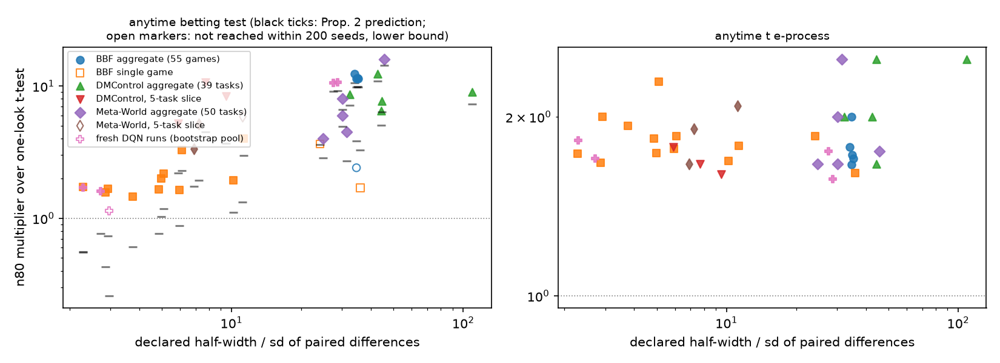

# Anytime Validity Is Nearly Free; Distribution-Free Validity Is What Costs Seeds: Decomposing the Price of Valid Sequential Comparison of RL Algorithms

*Conference-length version (RLC format). The full manuscript with appendices is `paper.md`; every number here is produced by the code in this folder.*

## Abstract

Comparisons of two RL algorithms are typically run for a fixed seed budget, or grown until a t-test looks significant; the second habit rejects a true null 36–54% of the time at nominal 5% in our simulations and 17–27% within 30 looks on fresh seeds. Anytime-valid tests fix this, and the betting test for bounded means (Waudby-Smith and Ramdas, 2023) has been proposed for RL. But at the 80%-power point it needs 1.8–5× the seeds of a one-look t-test on synthetic differences and 4–16× on released benchmark data. We ask which property is being paid for. The betting test bundles validity at every stopping time (*anytime*) with validity for every distribution on a declared interval (*distribution-free*). We separate them with tests that have one property and not the other: the anytime t-test e-process (Pérez-Ortiz et al., 2024) and group-sequential designs (anytime, parametric), and the betting martingale read once at a fixed \(n\) (fixed-\(n\), distribution-free). Anytime validity is cheap: the betting martingale read once needs the same seeds as the version stopped at first crossing on every setting (a consequence of Markov and Ville sharing the threshold \(1/\alpha\)), and the parametric e-process needs 1.6–2.0× the t-test with no maximum sample size. The rest is the price of the bound, set by the declared half-width over the noise: 1.8× at a ratio of 4, 12× at 34, 16× at 45. When the clip binds, the betting count is \(\approx h\log(1/\alpha)/\delta\), independent of the noise; on TD-MPC2's DMControl and Meta-World results, where a t-test needs two seeds, it predicts the betting test's 9–64 within 10–30%. Tightening the bound to what the data happen to satisfy recovers the parametric cost but is violated on 83% of paths. Where the noise fills the interval (single Atari games, bimodal Acrobot outcomes) the betting test matches the parametric anytime test and is correct on distributions the latter only models. Four hundred and eighty fresh DQN runs confirm the resampled counts within 1–4 seeds and show both regimes side by side.

## 1 Introduction

A claim that algorithm A beats B is a claim about the mean of paired per-seed differences. The community has become careful about summarizing those means (Henderson et al., 2018; Agarwal et al., 2021; Patterson et al., 2023) and much less careful about *when the comparison stops*. Running a few seeds, looking, and adding seeds if the result is "almost significant" is common, unreported, and does not have type I error \(\alpha\): in every null we simulated it rejected 36–54% of the time within 200 seeds, and 17–27% within 30 on genuinely independent runs.

Anytime-valid tests (Robbins, 1970; Howard et al., 2021; Ramdas et al., 2023) permit that behavior. The betting test for bounded means is the natural RL candidate: clipped human-normalized scores give differences in \([-1, 1]\) by construction. It also costs seeds. An earlier version of this work measured 2–5× over a t-test sized for the effect; this paper asks what the extra seeds buy. The betting test bundles two guarantees, anytime validity and distribution-free validity on the declared interval; we fill in the two-by-two table of (anytime or fixed-\(n\)) × (parametric or distribution-free) and read the cost of each property off a row or a column.

**Contributions.** (1) Within the distribution-free family the anytime property costs zero seeds at 80% power on every setting, which follows from Markov's and Ville's inequalities sharing the threshold \(1/\alpha\) (Proposition 1); within the parametric family it costs 1.6–2.0× with no planned maximum. (2) The bound is the cost: the betting multiplier over the t-test is monotone in \(h/\mathrm{sd}\), from 1× to 16×, and when the clip binds the count is \(\approx h\log(1/\alpha)/\delta\) (Proposition 2, informal), independent of the noise. (3) Tightening the bound to what the data satisfy is not valid: the bounds that look safe are the ones that fail. (4) Real data in three regimes: BBF Atari-100k aggregates (Gaussian, loose bound), single games (bimodal, tight), and TD-MPC2 on DMControl and Meta-World (enormous effects, loose bound), where the t-test needs 2–4 seeds and the betting test 9–64. (5) 480 fresh DQN runs: exact nulls on real seed noise, genuine paired streams that agree with the bootstrap within 1–4 seeds, and both regimes in one experiment. (6) Recommendations keyed to what one is willing to assume.

## 2 Related work

Henderson et al. (2018) and Colas et al. (2018) established that few seeds cannot distinguish typical effects and gave fixed-\(n\) power calculations; Agarwal et al. (2021) proposed interval estimates of aggregates (`rliable`), whose optimality-gap transform is our aggregate seed; Jordan et al. (2020) and Patterson et al. (2023) treat experimental design more broadly. None treats the stopping rule as part of the design. Anytime-valid inference runs from Darling and Robbins (1967) through Howard et al. (2021) to the e-value framework of Ramdas et al. (2023) and Grünwald et al. (2024); the betting test and empirical-Bernstein confidence sequence are Waudby-Smith and Ramdas (2023), the anytime t-test e-process is Pérez-Ortiz et al. (2024), and Johari et al. (2022) documented peeking inflation in A/B testing. Clinical trials solved peeking with group-sequential boundaries (Pocock, 1977; O'Brien and Fleming, 1979; Lan and DeMets, 1983), which we use as the parametric anytime baseline with a planned maximum. The tests are not new; the decomposition is.

## 3 Setup and tests

We observe paired differences \(x_1, x_2, \ldots\) on the raw score scale and test \(H_0: \mathbb E[x] = 0\) two-sided at \(\alpha = 0.05\). Tests that need \([0,1]\) rescale from a declared interval \([L, H]\), \(u_i = (x_i - L)/(H - L)\), null at \(m_0 = -L/(H - L)\); an observation outside the interval is clipped and the violation recorded, since the guarantee is void on that path. A test is *anytime-valid* if \(\mathbb P_{H_0}(\exists n: R_n = 1) \le \alpha\); *distribution-free on \([L,H]\)* if the guarantee holds for every mean-zero distribution supported there. For each setting and test we report \(n_{80}\), the smallest \(n\) at which the probability of having rejected by \(n\) is 0.8 (400 paths, cap 200; standard error 1–2 seeds), and the mean stopping time \(\mathbb E[n]\) with non-rejecting paths counted at the cap; nulls use 1,000 paths (standard error 0.007 near 0.05).

| | Parametric | Distribution-free on \([L,H]\) |
|---|---|---|
| Fixed \(n\) | one-look t-test | betting martingale, one look (Markov) |
| Anytime | t-test e-process; group-sequential to \(n_{\max}\) | betting martingale, first crossing (Ville); EB confidence sequence |

*One-look t-test*: reject at the committed \(n\) if \(p < \alpha\); under normality \(n_{80} \approx 7.85\,\sigma^2/\delta^2\). *Peeking t-test* (invalid baseline): look after every seed from \(n = 2\), stop at first \(p < \alpha\). *Group-sequential*: five looks at \(k n_{\max}/5\), Pocock (constant boundary) and O'Brien–Fleming (\(c\sqrt{5/k}\)), constants calibrated by 20,000 Gaussian null paths (2.42 and 2.05), \(n_{\max} = \max(10, 2 n_{80}(\text{t}))\), cannot reject after \(n_{\max}\). *Anytime t e-process*: \(E_n = \int f_{n-1,\delta\sqrt n}(T_n)\,\mathrm d\Pi(\delta)/f_{n-1}(T_n)\) with \(\delta \sim \mathcal N(0, g^2)\), \(g = 1\) (0.3 as a check), a nonnegative martingale under \(H_0\) for every \(\sigma\) (Pérez-Ortiz et al., 2024); reject at first \(E_n \ge 1/\alpha\). *Betting test*: predictable plug-in wealth \(M_t = \prod_{i \le t}(1 + \lambda_i(u_i - m_0))\), \(\lambda_i = \mathrm{clip}((\hat\mu_{i-1} - m_0)/\hat v_{i-1}, \pm 0.99/\max(m_0, 1 - m_0))\), so \(|\lambda| \le 1.98\) at \(m_0 = 1/2\); anytime version rejects at first \(M_t \ge 1/\alpha\) (Ville), one-look version at the committed \(n\) (Markov). *EB-CS*: the predictable plug-in empirical-Bernstein confidence sequence of Waudby-Smith and Ramdas (2023, Thm. 2), reject when it excludes \(m_0\).

**Proposition 1.** For a nonnegative test martingale \((M_n)\), \(M_0 = 1\), the fixed-\(n\) test \(M_n \ge 1/\alpha\) is valid by Markov and the anytime test (first \(t\) with \(M_t \ge 1/\alpha\)) by Ville, with the same threshold; the anytime test rejects by \(n\) whenever the fixed-\(n\) test does, so \(n_{80}(\text{anytime}) \le n_{80}(\text{fixed-}n)\). *Proof.* \(\mathbb E_{H_0} M_n = 1\) gives both inequalities at \(1/\alpha\); \(M_n \ge 1/\alpha \Rightarrow \sup_{t \le n} M_t \ge 1/\alpha\). \(\square\)

**Proposition 2 (informal).** With unit-scale gap \(\delta_u\), variance \(\sigma_u^2\), and clip \(c\), the log-optimal wager is \(\approx \delta_u/\sigma_u^2\); if it exceeds \(c\) the clip binds, \(\log M_t\) grows by \(\approx c\delta_u\) per observation, and \(n_{\mathrm{bet}} \approx \log(1/\alpha)/(c\delta_u) = 2h\log(1/\alpha)/(c\delta) \approx h\log(1/\alpha)/\delta\) for \(c \approx 2\): linear in the declared half-width \(h\), independent of the noise, whereas the t-test's count is \(\approx 7.85\sigma^2/\delta^2\) and independent of the bound.

## 4 Data

**Synthetic.** \(x = \mathrm{Beta}(a,b) - \mathrm{Beta}(b,a)\), concentration \(a + b \in \{8, 24, 80\}\), gap 0.14, sd 0.234 / 0.141 / 0.077, bound \([-1,1]\); nulls with \(a = b\), plus Gaussian, \(t_3\), and skewed-exponential nulls at sd 0.1.

**BBF on Atari-100k** (Schwarzer et al., 2023): per-run human-normalized scores for BBF and five ablations, 55 games, 12–60 runs per game, clipped to \([0,1]\) (the optimality-gap transform), so a paired difference is in \([-1,1]\) by construction. An *aggregate seed* draws one run per game per algorithm and averages over 55 games (sd 0.028–0.030, \(h/\mathrm{sd} \approx 34\)); a *single-game seed* is one paired difference on one game (sd 0.03–0.44, heavy-tailed, bimodal); eight games were fixed by a pre-stated rule. Nulls: BBF against itself.

**TD-MPC2** (Hansen et al., 2024): per-seed results for TD-MPC2, DreamerV3, SAC, TD-MPC on 39 DMControl tasks (reward/1000) and 50 Meta-World tasks (success), three seeds per task. Aggregate seeds over all tasks (sd 0.009–0.041, gaps 0.05–0.55) and *five-task slices* (a random five tasks per path; sd 0.09–0.17).

**Fresh runs.** We trained DQN (Adam \(10^{-3}\), Polyak target), Double DQN, and DQN at \(3 \times 10^{-4}\) on CartPole, Acrobot, MinAtar Breakout and Space Invaders: 60/40/40 seeds per agent on classic control, 40/30/30 on MinAtar, 480 runs. Score = mean of 10 evaluation returns, mapped to \([0,1]\) by a rule fixed in advance (CartPole \(R/500\), Acrobot \((R+500)/500\), MinAtar \(\min(R/100,1)\)). CartPole and Acrobot scores are bimodal (sd 0.18–0.33), Breakout tight (sd 0.014–0.034), Space Invaders between. A *genuine paired stream* is a random disjoint pairing of A's seeds with B's (no run reused; 400 pairings per setting; cap = pool size 30–40); a *genuine null* pairs an agent's seeds with themselves disjointly (20–30 pairs; 1,000 permutations). The same pools are also run as bootstrap streams to 200.

## 5 Validity

| Null | sd | peek t | Pocock | OBF | anytime t | betting | EB-CS | one-look t (\(n{=}10\)) |
|---|---:|---:|---:|---:|---:|---:|---:|---:|
| beta, conc. 8 / 24 / 80 | 0.24 / 0.14 / 0.08 | 0.43 / 0.45 / 0.41 | 0.051 / 0.055 / 0.052 | 0.049 / 0.061 / 0.034 | 0.034 / 0.036 / 0.031 | 0.030 / 0.014 / 0.001 | 0.000 | 0.046 / 0.039 / 0.049 |
| Gaussian / \(t_3\) | 0.10 / 0.09 | 0.42 / 0.42 | 0.051 / 0.050 | 0.047 / 0.055 | 0.030 / 0.028 | 0.003 / 0.006 | 0.000 | 0.046 / 0.048 |
| skewed exponential | 0.10 | 0.54 | 0.055 | 0.058 | **0.109** | 0.003 | 0.000 | **0.111** (0.12 at \(n{=}5\)) |
| BBF vs BBF, aggregate | 0.029 | 0.43 | 0.057 | 0.046 | 0.040 | 0.000 | 0.000 | 0.052 |
| BBF vs BBF, Pong / Kangaroo / Frostbite | 0.19 / 0.36 / 0.31 | 0.39 / 0.36 / 0.41 | 0.036 / 0.047 / 0.049 | 0.044 / 0.054 / 0.043 | 0.017 / 0.014 / 0.028 | 0.022 / 0.023 / 0.024 | 0.000 | 0.034 / 0.035 / 0.050 |
| TD-MPC2 nulls (6: two suites × TD-MPC2 aggregate, SAC aggregate, 5-task slice) | 0.007–0.069 | 0.39–0.44 | 0.038–0.058 | 0.038–0.054 | 0.026–0.037 | 0.000–0.005 | 0.000 | 0.040–0.049 |
| Fresh DQN exact nulls (8; 15–30 pairs) | 0.05–0.42 | **0.17–0.27** | 0.013–0.067 | 0.041–0.061 | 0.002–0.024 | 0.000–0.022 | 0.000 | 0.040–0.057 |

Peeking is the failure: 36–54% within 200 looks, 17–27% within 15–30 looks on exact nulls built from independent runs. The group-sequential designs sit at \(\alpha\) everywhere, including the skewed null, because their first look is late. The anytime t e-process and the one-look t-test fail in the same place and by the same amount (10.9% and 12% on the skewed null at small \(n\)); the e-process is the t-test's small-\(n\) non-normality made visible at every \(n\), and \(g = 0.3\) halves it. The betting test never exceeds 3% and is very conservative when the noise is far inside the bound, the same mechanism that costs it power. EB never rejected a true null.

## 6 Cost, decomposed

| Setting | gap | sd | \(h/\mathrm{sd}\) | one-look t | Pocock | OBF | anytime t | betting, one look | betting, anytime | EB-CS |
|---|---:|---:|---:|---:|---:|---:|---:|---:|---:|---:|
| beta, conc. 8 | 0.140 | 0.234 | 4.3 | 23 | 35 | 35 | 43 | 44 | 42 | 131 |
| beta, conc. 24 | 0.142 | 0.141 | 7.1 | 11 | 16 | 16 | 18 | 32 | 32 | 118 |
| beta, conc. 80 | 0.139 | 0.077 | 13 | 5 | 8 | 8 | 9 | 27 | 27 | 112 |
| beta, conc. 80, bound \(\pm 0.5\) | 0.141 | 0.078 | 6.4 | 5 | 8 | 8 | 9 | 16 | 16 | 57 |
| BBF vs −SPR / −Resets / −WD / +sticky / RR8, aggregate | +0.031 / +0.102 / +0.009 / +0.027 / −0.030 | 0.029 | 34 | 9 / 3 / 83 / 11 / 10 | 12 / 4 / 133 / 18 / 12 | 16 / 6 / 133 / 18 / 16 | 16 / 6 / 138 / 19 / 17 | 111 / 34 / >200 / 126 / 114 | 111 / 34 / >200 / 126 / 114 | >200 / 149 / >200 / >200 / >200 |

**Anytime is free inside the betting family.** One-look and first-crossing betting have the same \(n_{80}\) on every row (44/42, 32/32, 27/27, 16/16, 111/111, 34/34, 126/126, 114/114): Proposition 1 says the anytime version cannot be worse, and on the alternative the wealth is nearly monotone so it is not measurably better.

**Anytime costs 1.6–2.0× inside the parametric family, with no maximum.** The e-process needs 43/23, 18/11, 9/5 and 16/9, 6/3, 138/83, 19/11, 17/10; expected stopping times are 1.1–1.7× the t-test's committed \(n\). Five-look group-sequential designs are slightly cheaper at \(n_{80}\) because they are handed \(n_{\max}\), and equivalent in \(\mathbb E[n]\).

**The bound is the cost.** The betting multiplier over the t-test is 1.8× at \(h/\mathrm{sd} = 4.3\), 2.9× at 7.1, 5.4× at 13, 11–12× at 34. Halving the bound on conc. 80 (legitimate: no draw of 160,000 exceeded 0.45) cuts the betting cost from 27 to 16 and moves nothing else. The betting counts (42, 32, 27) barely move while the noise falls threefold and the t-test's fall from 23 to 5: the count is governed by the unit-scale gap, as Proposition 2 says. EB (112–131, mostly >200) shows variance adaptivity does not escape the bound; the binding constraint is capital reserved for an observation at the edge of the interval.

**Swept** (BBF vs −SPR aggregate, sd 0.029): half-width 1 / 0.5 / 0.25 / 0.1 / 0.05 costs 111 / 60 / 34 / 19 / 16 betting seeds against 16–17 for the e-process, with Proposition 2 predicting 97 / 48 / 24 / 10 / 5; but at 0.1 the bound was violated on 83% of 200-seed paths and at 0.05 on 100%. A bound of 0.1 is 3.4 standard deviations and looks safe from ten seeds. Only bounds at 8.6 standard deviations or more held on every path, and they cost 3.8× and 6.7× the t-test. There is no free tightening.

## 7 Three real-data regimes

*Figure 1. Every real-data power setting. Left: the anytime betting test's \(n_{80}\) as a multiple of the one-look t-test's, against declared half-width over standard deviation; black ticks are Proposition 2's prediction; open markers are lower bounds. Right: the parametric anytime e-process.*

**Noise fills the bound: single Atari games.** On eight games against two ablations (gaps −0.36 to +0.23, sd 0.03–0.44), where \(h/\mathrm{sd} < 6\) the betting test needs about the same as the e-process and is ahead on six of eight rows (ChopperCommand RR8 26 vs 26; −SPR 30 vs 36; Frostbite 72 vs 77; Kangaroo 64 vs 85; Zaxxon −SPR 71 vs 79; Asterix RR8 52 vs 55; Qbert 77 vs 83); where \(h/\mathrm{sd} > 10\) the e-process is 2× cheaper (Hero RR8 25 vs 56) or the betting test does not finish (Alien). The distributional guarantee comes for roughly nothing exactly when the data are bimodal enough to want it.

**Enormous effects, loose bound: TD-MPC2.** Aggregate gaps are 0.05–0.55 at sd 0.009–0.041 (\(\delta/\sigma\) 2–24). The t-test needs 2–4 seeds; the betting test 9–64, ordered by the gap (9 at 0.55, 12–13 at 0.30–0.35, 18 at 0.20, 23–26 at 0.14–0.16, 37 at 0.09, 64 at 0.05), with Proposition 2's \(3.0/\delta\) 10–30% low on eight of ten rows and 40–70% low on the two largest gaps where the count is under ten. The multiplier is 4–16×, the largest in the paper, because the t-test is so cheap. The e-process has a floor of five observations regardless of effect (with one to three degrees of freedom its likelihood ratio cannot reach 20 under the \(g = 1\) prior), so its multiplier is 1.7–2.5× here. The bound sweep repeats (DMC TD-MPC2 vs TD-MPC: 23 → 13 → 8 at \(h = 1, 0.5, 0.25\), no violations; 6 at 0.1 with 100% violated). Five-task slices (\(h/\mathrm{sd} = 6\)–\(11\)) land between: t 3–34, e-process 5–71, betting 10 to >200; multipliers 3–11× over the t-test and 2–6× over the e-process.

| Suite, comparison | gap | sd | \(h/\mathrm{sd}\) | one-look t | Pocock | anytime t | betting | EB-CS | \(3.0/\delta\) |
|---|---:|---:|---:|---:|---:|---:|---:|---:|---:|
| DMC, TD-MPC2 vs DreamerV3 / SAC / TD-MPC | +0.205 / +0.296 / +0.157 | 0.009 / 0.023 / 0.023 | 111 / 43 / 43 | 2 / 2 / 3 | 4 / 4 / 4 | 5 / 5 / 5 | 18 / 13 / 23 | 73 / 51 / 96 | 15 / 10 / 19 |
| DMC, DreamerV3 vs SAC; TD-MPC vs SAC | +0.091 / +0.139 | 0.023 / 0.031 | 43 / 32 | 3 / 3 | 4 / 4 | 6 / 6 | 37 / 26 | 165 / 108 | 33 / 22 |
| MW, TD-MPC2 vs DreamerV3 / SAC / TD-MPC | +0.551 / +0.201 / +0.052 | 0.032 / 0.033 / 0.022 | 31 / 30 / 45 | 2 / 3 / 4 | 4 / 4 / 6 | 5 / 5 / 7 | 9 / 18 / 64 | 28 / 75 / >200 | 5 / 15 / 58 |
| MW, DreamerV3 vs SAC; TD-MPC vs SAC | −0.348 / +0.151 | 0.040 / 0.033 | 25 / 30 | 3 / 3 | 4 / 4 | 5 / 6 | 12 / 24 | 44 / 101 | 9 / 20 |
| DMC 5-task: TD-MPC2 vs TD-MPC / DreamerV3; TD-MPC vs SAC | +0.162 / +0.221 / +0.152 | 0.105 / 0.130 / 0.169 | 9.5 / 7.7 / 5.9 | 5 / 3 / 9 | 6 / 4 / 13 | 8 / 5 / 16 | 42 / 32 / 47 | 186 / 140 / 198 | 19 / 14 / 20 |
| MW 5-task: TD-MPC2 vs TD-MPC / DreamerV3; TD-MPC vs SAC | +0.066 / +0.570 / +0.140 | 0.089 / 0.145 / 0.138 | 11 / 6.9 / 7.2 | 34 / 3 / 11 | 59 / 4 / 18 | 71 / 5 / 21 | >200 / 10 / 57 | >200 / 33 / >200 | 45 / 5 / 21 |

**Fresh seeds, no resampling.** Eight exact nulls hold \(\alpha\) for every valid test (Section 5). Four of twelve comparisons have a detectable gap:

| Comparison | gap | sd | \(h/\mathrm{sd}\) | stream (cap) | one-look t | Pocock | anytime t | betting | \(\mathbb E[n]\): anytime t / betting |
|---|---:|---:|---:|---|---:|---:|---:|---:|---|
| Acrobot, DQN vs lr \(3{\times}10^{-4}\) | +0.32 | 0.43 | 2.3 | genuine (40) / bootstrap (200) | 18 / 17 | 27 / 23 | 28 / 31 | **28** / 29 | 19 / 20 · 21 / 21 |
| Acrobot, Double DQN vs lr \(3{\times}10^{-4}\) | +0.39 | 0.37 | 2.7 | genuine (40) / bootstrap | 9 / 10 | 12 / 14 | 16 / 17 | **16** / 16 | 12 / 13 · 12 / 13 |
| Breakout, DQN vs lr \(3{\times}10^{-4}\) | +0.041 | 0.036 | 28 | genuine (30) / bootstrap | 8 / 8 | 13 / 11 | 14 / 14 | **>30 (0%)** / 85 | 11 / 30 · 11 / 79 |
| Breakout, Double DQN vs lr \(3{\times}10^{-4}\) | +0.046 | 0.035 | 29 | genuine (30) / bootstrap | 7 / 7 | 11 / 11 | 11 / 11 | **>30 (0%)** / 75 | 9 / 30 · 9 / 70 |

Genuine and bootstrap \(n_{80}\) agree within 1–4 seeds for every test wherever both exist, so the resampled streams behind the rest of the paper are a correct sample-size calculation on these comparisons. The regimes recur: on bimodal Acrobot differences the betting test needs exactly as many fresh pairs as the e-process (28 vs 28, 16 vs 16) and is valid for that distribution; on tight Breakout differences the t-test needs 7–8, the e-process 11–14, and the betting test rejects on 0 of 400 genuine 30-pair streams (at a wager of 2 and a unit-scale gap of 0.02, its log-wealth cannot reach \(\log 20\) in 30 steps), with the bootstrap putting it at 75–85 where Proposition 2 predicts 65–73. The other eight comparisons (\(\delta/\sigma \le 0.2\)) are undetectable at 40 seeds by any test, valid or not, and peeking would have declared a winner 17–27% of the time.

## 8 Recommendations

1. Do not look after every seed and stop at the first \(p < 0.05\).
2. If you commit to \(n\) and look once, a t-test is cheapest; use a power analysis and do not add seeds after looking. It inflates on skewed differences at small \(n\) (12% at \(n = 5\)).
3. If you want to stop whenever you like and will assume approximate normality, use the anytime t e-process: no planned maximum, 1.6–2.0× the t-test at 80% power, 1.1–1.7× in expected seeds, a floor of five observations; or a five-look group-sequential design if you can commit to a maximum, which is also robust to skew because its first look is late.
4. If you cannot assume normality, use the betting test with the tightest interval you can defend *before* looking. Expect \(\approx h\log(1/\alpha)/\delta\) seeds, linear in the half-width, independent of the noise, and independent of how large the effect is in standard deviations: at a gap of 0.05 on the unit interval it needs about 60 seeds however small the noise. Expect parity with the e-process when \(h/\mathrm{sd} \lesssim 6\).
5. Do not declare a bound from the range of the data you have: a half-width at 3.4 standard deviations looked safe and was violated on 83% of paths.
6. Aggregates (Gaussian, \(h/\mathrm{sd} \approx 30\)–\(110\)) call for the parametric anytime test; single games and bimodal per-environment outcomes (\(h/\mathrm{sd}\) 2–6) call for the betting test at no cost.
7. A 30–40-seed budget resolves standardized effects of about 0.75 and larger with any valid anytime test, and nothing much smaller with any test.

## 9 Discussion and limitations

The seeds a betting test spends buy insurance against distributions one has not seen, in an amount proportional to the declared interval; the sequential property itself costs 1.6–2.0× under normality and exactly 1× within the betting family. That turns "can we afford anytime validity" into "how tight an interval can we honestly declare," a question about the metric. A 55-task aggregate keeps the interval at \([-1,1]\) while averaging shrinks the noise, which is why a distribution-free test pays most there and why a huge effect in standard-deviation units can still be a small one in interval units. Where the edge of the interval is reachable (a seed that solves a level against one that does not) both families make the same reservation and the betting test is as cheap as the parametric one while being correct on the bimodal distributions the latter only models.

Limitations. Released-data streams are resamples from 12–60 runs per game or three per task; the fresh runs validate them only up to \(n_{80} \approx 31\), and counts above the pool size rest on the bootstrap alone. The TD-MPC2 per-task pools of three are too thin for per-task comparisons and we report none. The fresh runs are three variants of one algorithm family on four small environments, untuned, with 30–40 pairs per genuine path, which cannot speak to tests whose cost exceeds the pool, which is where the betting test lands on Breakout. Seeds within a configuration share code and hyperparameters, inducing dependence no test here models. Group-sequential designs were given \(n_{\max} = 2 n_{80}(\text{t})\), which uses knowledge a practitioner would need from a power analysis; the e-process's prior scale moves \(n_{80}\) by −2 to +6 seeds. Proposition 2 is a heuristic, 10–40% low where the clip binds and inapplicable where it does not. We did not try bounds that adapt validly over time.

## 10 Conclusion

A valid sequential comparison costs more seeds than an invalid one, and that cost is two multipliers, not one. Stopping whenever you like costs 1.6–2.0× under a Gaussian model and 1× within the betting family. Being right about every distribution on a declared interval costs a factor set by how loose the interval is relative to the noise, from 1× when the noise fills it to 16× when it fills 1–3% of it, whatever the size of the effect, and it cannot be reduced by tightening the interval after looking. Parametric anytime for aggregates and for anyone willing to assume normality; distribution-free betting for single games, bimodal outcomes, skewed differences, and anyone who is not. Four hundred and eighty fresh runs say the resampled numbers behind that rule are the right ones.

## References

Agarwal et al. (2021). Deep RL at the edge of the statistical precipice. NeurIPS. · Colas, Sigaud, Oudeyer (2018). How many random seeds? arXiv:1806.08295. · Darling, Robbins (1967). Confidence sequences for mean, variance, and median. PNAS. · Grünwald, de Heide, Koolen (2024). Safe testing. JRSS-B. · Hansen, Su, Wang (2024). TD-MPC2. ICLR. · Henderson et al. (2018). Deep RL that matters. AAAI. · Howard, Ramdas, McAuliffe, Sekhon (2021). Time-uniform, nonparametric, nonasymptotic confidence sequences. Ann. Stat. · Johari, Koomen, Pekelis, Walsh (2022). Always valid inference. Oper. Res. · Jordan et al. (2020). Evaluating the performance of RL algorithms. ICML. · Lan, DeMets (1983). Discrete sequential boundaries for clinical trials. Biometrika. · O'Brien, Fleming (1979). A multiple testing procedure for clinical trials. Biometrics. · Patterson, Neumann, White, White (2023). Empirical design in RL. arXiv:2304.01315. · Pérez-Ortiz, Lardy, de Heide, Grünwald (2024). E-statistics, group invariance and anytime-valid testing. Ann. Stat. · Pocock (1977). Group sequential methods. Biometrika. · Ramdas, Grünwald, Vovk, Shafer (2023). Game-theoretic statistics and safe anytime-valid inference. Stat. Sci. · Robbins (1970). Statistical methods related to the law of the iterated logarithm. Ann. Math. Stat. · Schwarzer et al. (2023). Bigger, better, faster. ICML. · Ville (1939). Étude critique de la notion de collectif. · Waudby-Smith, Ramdas (2023). Estimating means of bounded random variables by betting. JRSS-B. · Young, Tian (2019). MinAtar. arXiv:1903.03176.

*Appendices (full test definitions, data construction, complete result tables, Proposition 2 against the data, prior sensitivity, the earlier draft's kill test) are in `paper.md`.*
