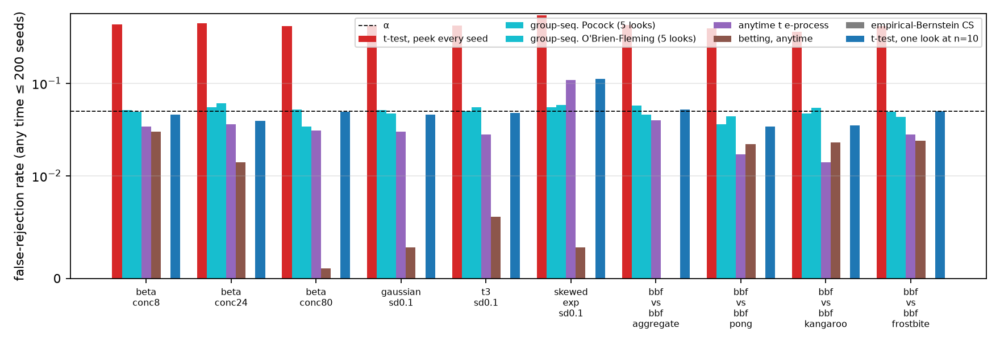
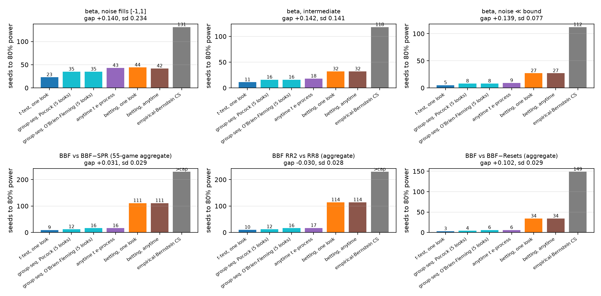
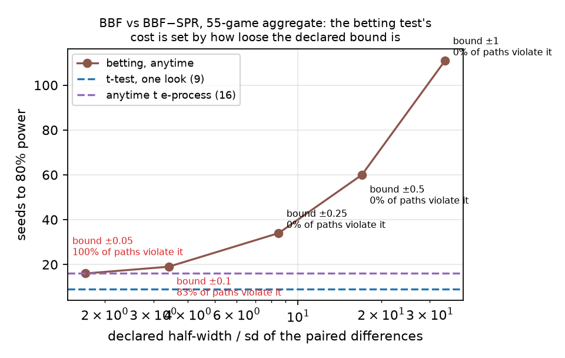
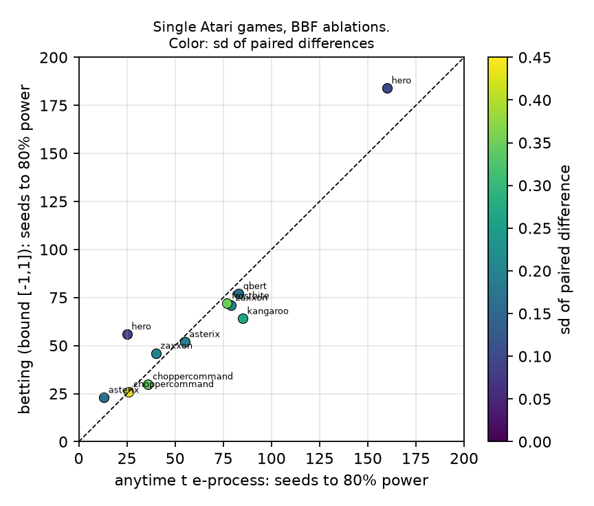

# Anytime validity is nearly free; distribution-free validity is what costs seeds

**Draft.** Every number below is produced by the scripts in this folder: `s4_anytime.py` (the original beta and gridworld runs), `s4_extensions.py` (everything else), and `make_figures.py`. The real seed data are the per-run human-normalized Atari-100k scores released with BBF (Schwarzer et al., 2023), copied into `data/bbf/`. Nothing was trained.

## Abstract

Comparisons of two RL algorithms are run for a fixed seed budget, or grown until a t-test looks significant. The second habit rejects a true null 36–54% of the time in our simulations at nominal 5%. A betting test on a bounded interval (Waudby-Smith and Ramdas) fixes that, but at the 80%-power point it needed 1.8–5.4× the seeds of a one-look t-test on synthetic differences and 11–12× on real Atari-100k seed data. We ask which property is being paid for. The betting test bundles two guarantees: validity at every stopping time (anytime) and validity for every distribution on a declared interval (distribution-free). Separating them with tests that have one property but not the other gives a clean answer. Anytime validity is cheap. The same betting martingale read once at a fixed \(n\) needs the same number of seeds as the version stopped at first crossing (44 vs 42, 32 vs 32, 27 vs 27, 111 vs 111), and a parametric anytime-valid t-test e-process needs 1.6–2.0× the one-look t-test with no maximum sample size, about the same as a five-look group-sequential design. The 2–12× is the price of the bound. It is set by the ratio of the declared half-width to the noise: 1.8× when paired differences fill the interval, 5.4× when their standard deviation is 8% of it, 12× when it is 3% of it, as it is for 55-game aggregate scores. Tightening the declared bound to a value the data happen to satisfy recovers the parametric cost (19 seeds vs 16), but on 83% of paths that bound was violated, so the recovered saving is not valid. On skewed differences the parametric tests inflate (t-test at \(n=5\): 12%; e-process: 11%) while the betting test stays at 0.3%. The recommendation follows: if you can stand behind a Gaussian approximation, use an anytime-valid t-test and stop whenever you like; if you cannot, declare the tightest interval you can defend, and plan on the multiplier.

## 1. The question

A comparison of two algorithms is a mean of paired seed differences. Two protocols are common: commit to \(n\) seeds and run a t-test, or add seeds until the t-test is significant and stop. The second protocol does not have type I error \(\alpha\). An anytime-valid test does: the probability of ever rejecting a true null, at any data-dependent stopping time, is at most \(\alpha\).

The version of this paper that preceded the present draft measured the betting test of Waudby-Smith and Ramdas against a t-test sized for the effect at hand and found it needed 2–5× more seeds, with the multiplier set by how loose the declared bound was relative to the noise. That is correct and it is also incomplete, because it does not say what was bought with the extra seeds. The betting test is anytime-valid and it is distribution-free on the declared interval. A reader who wants to peek after every seed but is willing to assume approximate normality pays for both and uses one.

This draft separates the two. For each property we add a test that has it and not the other:

- **Anytime, parametric.** The anytime-valid t-test e-process of Pérez-Ortiz, Lardy, de Heide, and Grünwald (2024), and five-look group-sequential designs with Pocock and O'Brien–Fleming boundaries (Pocock 1977; O'Brien and Fleming 1979), which are the clinical-trials answer to peeking.
- **Fixed-\(n\), distribution-free.** The betting martingale evaluated once, at a pre-committed \(n\), rejecting when wealth exceeds \(1/\alpha\) by Markov's inequality.

Against the one-look t-test (neither property) and the anytime betting test (both), these span the two-by-two table. We also add the empirical-Bernstein confidence sequence of Waudby-Smith and Ramdas as a second distribution-free anytime method, and the invalid peeking t-test as the failure the methods prevent.

## 2. Tests

Observations are paired differences \(x_1, x_2, \ldots\) on the raw scale. Where a test needs them on \([0,1]\), they are rescaled from a declared interval \([L, H]\) and the null mean 0 lands at \(m_0 = -L/(H-L)\). All tests are two-sided at \(\alpha = 0.05\).

**t-test, one look.** Reject at the committed \(n\) if the one-sample t-test of mean 0 has \(p < \alpha\).

**t-test, peek.** Look after every seed from \(n = 2\), stop at the first \(p < \alpha\). Invalid.

**Group-sequential, five looks.** Looks at \(n_k = \lceil k\,n_{\max}/5 \rceil\). At look \(k\) convert the t-test \(p\)-value to \(z_k = \Phi^{-1}(1 - p_k/2)\). Pocock rejects when \(z_k \ge c_P\); O'Brien–Fleming when \(z_k \ge c_O \sqrt{5/k}\). The constants are calibrated by 20,000 Monte Carlo Gaussian null paths so the probability of crossing at any look is exactly \(\alpha\). The design needs a planned maximum. We set \(n_{\max}\) to twice the one-look t-test's \(n_{80}\) for the setting, which is a generous power analysis, and the test cannot reject after \(n_{\max}\). This is anytime-valid up to \(n_{\max}\), under the Gaussian model.

**Anytime t e-process.** With \(T_n\) the t-statistic and a prior \(\delta \sim \mathcal N(0, g^2)\) on the standardized effect,

\[
E_n = \frac{\int f_{n-1,\,\delta\sqrt n}(T_n)\, \mathrm d\Pi(\delta)}{f_{n-1}(T_n)},
\]

where \(f_{\nu,\lambda}\) is the noncentral \(t\) density and \(f_\nu\) the central one. The density ratio of the scale-maximal invariant depends on the data only through \(T_n\), and \((E_n)\) is a nonnegative martingale under the null with respect to the invariant filtration (Pérez-Ortiz et al., 2024), so Ville's inequality gives \(\mathbb P(\exists n: E_n \ge 1/\alpha) \le \alpha\). We reject at the first \(E_n \ge 1/\alpha\). The integral is a 40-point Gauss–Hermite sum. \(g = 1\) in the tables; \(g = 0.3\) is reported as a sensitivity check. No maximum sample size.

**Betting, anytime.** The predictable plug-in martingale of the earlier draft: \(\lambda_t = \mathrm{clip}\!\big((\hat\mu_{t-1} - m_0)/v_{t-1},\ \pm 0.99/\max(m_0, 1-m_0)\big)\), \(\log M_t = \sum_{i \le t} \log(1 + \lambda_i (x_i - m_0))\), reject at the first \(M_t \ge 1/\alpha\) (Ville). Valid for any distribution on \([L, H]\).

**Betting, one look.** The same \(M_n\), read only at the committed \(n\), reject if \(M_n \ge 1/\alpha\) (Markov). Same threshold. The difference between this row and the previous one is exactly the cost of the anytime property inside the distribution-free family.

**Empirical-Bernstein CS.** The predictable plug-in EB confidence sequence of Waudby-Smith and Ramdas (2023, Thm 2) with \(\lambda_t = \min\big(\sqrt{2\log(2/\alpha)/(\hat\sigma_{t-1}^2\, t \log(t+1))},\ 1/2\big)\), intersected over time; reject when it excludes \(m_0\).

For each setting we report \(n_{80}\), the smallest \(n\) at which the probability of having rejected by \(n\) is at least 0.8, and for the sequential tests the mean stopping time \(\mathbb E[n]\) with the cap counted as the stopping time of a path that never rejects. Power settings use 400 paths and a cap of 200 seeds; nulls use 1,000 paths.

## 3. Data

**Beta differences.** \(x = \mathrm{Beta}(a, b) - \mathrm{Beta}(b, a)\) with \(a + b\) a concentration in \(\{8, 24, 80\}\) and \((a-b)/(a+b) = 0.14\), so the mean gap is 0.14 and the standard deviation is 0.23, 0.14, or 0.08. Declared bound \([-1, 1]\). These are the settings of the earlier draft.

**Real seeds: BBF on Atari-100k.** Schwarzer et al. (2023) released per-run human-normalized scores for BBF and its ablations on 55 games, 12–30 runs per game. We clip each score to \([0, 1]\), which is the quantity rliable's optimality gap is built from (Agarwal et al., 2021), so a paired difference is in \([-1, 1]\) by construction and the declared bound is not a guess. One *aggregate seed* draws one run per game for each algorithm and takes the mean clipped score over the 55 games; the paired difference of two aggregate seeds has standard deviation 0.028–0.030 across every comparison we ran. A *single-game seed* is a paired difference of clipped scores on one game; these have standard deviations from 0.03 to 0.44 and are far from Gaussian. A true null with real seed noise is BBF against itself with independent run draws. Seeds beyond the pool size are bootstrap replicates, which is the right object for a sample-size calculation but not a new run.

**Comparisons.** BBF (replay ratio 2) against: BBF without SPR (gap +0.031 in aggregate clipped score), without periodic resets (+0.102), without weight decay (+0.009), with sticky actions (+0.027), and against BBF at replay ratio 8 (−0.030). Single games were fixed before any test was run by one rule: BBF's clipped score has mean in \((0.05, 0.95)\) and standard deviation above 0.02, so clipping has not removed the signal; the eight chosen span gaps from −0.36 to +0.23.

**Other nulls.** Gaussian, scaled \(t_3\), and centered exponential (skewed) differences with standard deviation 0.1, clipped to \([-1, 1]\).

## 4. Validity

*Figure 3. False-rejection rate within 200 seeds on ten true nulls, 1,000 paths each. Dashed line is \(\alpha = 0.05\). The t-test with a look after every seed rejects 36–54% of true nulls. Every other method holds \(\alpha\), except the parametric ones on the skewed null.*

| Null | peek t | Pocock | OBF | anytime t | anytime t (\(g=0.3\)) | betting | EB-CS | one-look t at \(n=10\) |
|---|---:|---:|---:|---:|---:|---:|---:|---:|
| beta, sd 0.24 | 0.434 | 0.051 | 0.049 | 0.034 | 0.027 | 0.030 | 0.000 | 0.046 |
| beta, sd 0.14 | 0.446 | 0.055 | 0.061 | 0.036 | 0.026 | 0.014 | 0.000 | 0.039 |
| beta, sd 0.08 | 0.414 | 0.052 | 0.034 | 0.031 | 0.023 | 0.001 | 0.000 | 0.049 |
| Gaussian, sd 0.1 | 0.420 | 0.051 | 0.047 | 0.030 | 0.025 | 0.003 | 0.000 | 0.046 |
| \(t_3\), sd 0.1 | 0.418 | 0.050 | 0.055 | 0.028 | 0.020 | 0.006 | 0.000 | 0.048 |
| skewed exponential, sd 0.1 | 0.539 | 0.055 | 0.058 | **0.109** | 0.051 | 0.003 | 0.000 | **0.111** |
| BBF vs BBF, aggregate | 0.427 | 0.057 | 0.046 | 0.040 | 0.025 | 0.000 | 0.000 | 0.052 |
| BBF vs BBF, Pong | 0.393 | 0.036 | 0.044 | 0.017 | 0.016 | 0.022 | 0.000 | 0.034 |
| BBF vs BBF, Kangaroo | 0.361 | 0.047 | 0.054 | 0.014 | 0.018 | 0.023 | 0.000 | 0.035 |
| BBF vs BBF, Frostbite | 0.413 | 0.049 | 0.043 | 0.028 | 0.018 | 0.024 | 0.000 | 0.050 |

The standard error at 1,000 paths is about 0.007. Peeking is the failure. The group-sequential designs sit at \(\alpha\) because their first look is at \(n_{\max}/5 \ge 40\), by which point the t-statistic is close to Gaussian even on skewed data. The anytime t e-process and the one-look t-test are both at 11% on the skewed null: the e-process is a likelihood ratio under the Gaussian model, and at \(n = 5\) the one-look t-test is at 12%. Those two rows are the parametric assumption failing in the same place. The betting test never exceeds 0.030, and it is conservative when the noise is far inside the bound (0.000–0.003). The EB confidence sequence never rejected a true null in 10,000 paths, which foreshadows its power.

## 5. Cost, decomposed

*Figure 1. Seeds to 80% power. Top row: beta differences with gap 0.14 at three concentrations, declared bound \([-1,1]\). Bottom row: BBF aggregate comparisons, bound \([-1,1]\) by construction. Blue and cyan are parametric; purple is the parametric anytime e-process; orange and brown are the same betting martingale read once or stopped at first crossing; gray is the EB confidence sequence.*

| Setting | gap | sd | one-look t | Pocock | OBF | anytime t | betting, one look | betting, anytime | EB-CS |
|---|---:|---:|---:|---:|---:|---:|---:|---:|---:|
| beta, noise fills \([-1,1]\) | 0.140 | 0.234 | 23 | 35 | 35 | 43 | 44 | 42 | 131 |
| beta, intermediate | 0.142 | 0.141 | 11 | 16 | 16 | 18 | 32 | 32 | 118 |
| beta, noise \(\ll\) bound | 0.139 | 0.077 | 5 | 8 | 8 | 9 | 27 | 27 | 112 |
| same, declared bound \([-0.5, 0.5]\) | 0.141 | 0.078 | 5 | 8 | 8 | 9 | 16 | 16 | 57 |
| BBF vs BBF−SPR, aggregate | +0.031 | 0.029 | 9 | 12 | 16 | 16 | 111 | 111 | >200 |
| BBF vs BBF−Resets, aggregate | +0.102 | 0.029 | 3 | 4 | 6 | 6 | 34 | 34 | 149 |
| BBF vs BBF−WD, aggregate | +0.009 | 0.029 | 83 | 133 | 133 | 138 | >200 | >200 | >200 |
| BBF vs BBF+sticky, aggregate | +0.027 | 0.029 | 11 | 18 | 18 | 19 | 126 | 126 | >200 |
| BBF RR2 vs RR8, aggregate | −0.030 | 0.028 | 10 | 12 | 16 | 17 | 114 | 114 | >200 |

Three things are in this table.

**Anytime is free inside the betting family.** The betting martingale read once at a fixed \(n\) and the same martingale stopped at its first crossing have the same \(n_{80}\) on every row (44/42, 32/32, 27/27, 111/111, 34/34, 126/126, 114/114). Markov's inequality at a fixed time and Ville's inequality over all times give the same threshold \(1/\alpha\) for a nonnegative martingale; the anytime version can only stop earlier. The earlier draft attributed the whole multiplier to "the price of validity." The price of *anytime* validity, holding the distributional assumption fixed, is zero here.

**Anytime costs 1.6–2.0× inside the parametric family, and no maximum \(n\) is needed.** The e-process needs 43/23, 18/11, 9/5 seeds on the beta settings and 16/9, 6/3, 138/83, 19/11, 17/10 on the real aggregates. The five-look group-sequential designs are a little cheaper at \(n_{80}\) (Pocock 35, 16, 8; 12, 4, 133, 18, 12) because they were handed a planned \(n_{\max}\) of twice the t-test's \(n_{80}\), and they cannot run past it. In expected stopping time the two are closer: on BBF vs BBF−SPR, Pocock stops at a mean of 11 seeds, OBF at 13, the e-process at 12, against the one-look t-test's committed 9. On the hardest real comparison, BBF vs BBF−WD (gap 0.009, sd 0.029), the e-process rejects on 96% of paths with a mean stopping time of 92 seeds, against a t-test committed to 83. Someone who is willing to assume approximate normality and wants to stop whenever they like pays about 1.1–1.7× in expected seeds and 1.6–2.0× at the 80%-power point.

**The bound is the cost.** The betting test's multiplier over the one-look t-test is 1.8× at sd 0.234, 2.9× at 0.141, 5.4× at 0.077, and 11–12× at 0.029. The ratio of the declared half-width to the noise standard deviation is 4.3, 7.1, 13, and 34 in those rows. Section 6 shows this is the whole story.

*Figure 2. BBF vs BBF−SPR, aggregate seeds. Seeds to 80% power for the anytime betting test as the declared half-width shrinks from 1 to 0.05 (sd of the differences is 0.029). Red labels are bounds that at least one observation in a path violated; the test's guarantee does not hold on those paths.*

## 6. The bound, swept

On BBF vs BBF−SPR, declaring half-width 1 (the true bound) costs 111 seeds; 0.5 costs 60; 0.25 costs 34; 0.1 costs 19; 0.05 costs 16. The last two are within 3 seeds of the parametric e-process (16). But at half-width 0.1 some observation left the interval on 83% of paths, and at 0.05 on 100% of paths. A bound of 0.25 (8.6 standard deviations) held on every one of 400 paths of 200 seeds and costs 34 seeds, 3.8× the t-test and 2.1× the e-process. A bound of 0.5 (17 sd) held and costs 60.

The mechanism is the clip on the betting fraction. Near \(m_0 = 1/2\) on the unit interval the fraction cannot exceed about 2, because a single observation at 0 or 1 would otherwise make the capital negative. The growth-optimal fraction for a shift \(\delta\) with variance \(\sigma^2\) is of order \(\delta/\sigma^2\). On the aggregate data, after rescaling to \([0,1]\) the shift is 0.0155 and the variance is \(2 \times 10^{-4}\), so the uncapped fraction is about 75, and the test is forced to bet at 2. A t-test does not reserve capital for a jump to the end of the interval. That reservation is what the extra seeds buy, and on the skewed null in Section 4 it is what kept the betting test at 0.3% while the parametric tests were at 11%.

The variance-adaptive EB confidence sequence does not escape this. It is a two-sided interval, its \(\lambda_t\) is also capped (at 1/2), and it needs 112–131 seeds on the beta settings and never reaches 80% power on the real aggregates within 200 seeds. A one-sided test built from the same bound would do better than the two-sided CS, but it cannot beat the plug-in bet, which is already the near-optimal one-sided wager under the same cap.

## 7. When the noise fills the bound, the two families agree

*Figure 4. Single-game comparisons, BBF against two ablations, declared bound \([-1,1]\). Each point is a game; horizontal is the anytime t e-process's \(n_{80}\), vertical the anytime betting test's. Color is the standard deviation of the paired difference. Games where no test reached 80% power within 200 seeds are omitted.*

| Game, comparison | gap | sd | one-look t | Pocock | anytime t | betting | \(\mathbb E[n]\) anytime t | \(\mathbb E[n]\) betting |
|---|---:|---:|---:|---:|---:|---:|---:|---:|
| Asterix, −SPR | −0.186 | 0.164 | 7 | 11 | 13 | 23 | 11 | 20 |
| Asterix, RR8 | −0.105 | 0.196 | 24 | 37 | 55 | 52 | 40 | 41 |
| ChopperCommand, −SPR | +0.227 | 0.342 | 18 | 27 | 36 | 30 | 27 | 24 |
| ChopperCommand, RR8 | −0.358 | 0.438 | 15 | 20 | 26 | 26 | 18 | 19 |
| Frostbite, RR8 | −0.151 | 0.350 | 46 | 69 | 77 | 72 | 51 | 48 |
| Kangaroo, RR8 | −0.112 | 0.266 | 44 | 67 | 85 | 64 | 65 | 50 |
| Zaxxon, −SPR | +0.091 | 0.206 | 43 | 70 | 79 | 71 | 53 | 56 |
| Zaxxon, RR8 | −0.127 | 0.201 | 23 | 37 | 40 | 46 | 28 | 36 |
| Qbert, RR8 | −0.073 | 0.168 | 47 | 66 | 83 | 77 | 56 | 60 |
| Hero, RR8 | −0.072 | 0.088 | 14 | 18 | 25 | 56 | 18 | 49 |
| Hero, −SPR | +0.028 | 0.098 | 95 | 160 | 160 | 184 | 105 | 139 |
| Alien, −SPR | −0.015 | 0.041 | 55 | 90 | 102 | >200 | 77 | 192 (33% reject) |
| Alien, RR8 | −0.008 | 0.028 | 118 | 160 | 190 | >200 | 121 | 200 (0%) |

Single-game differences of clipped scores are heavy-tailed, often bimodal, and have standard deviations up to 0.44 against a declared half-width of 1. Where the standard deviation is above about 0.16, the betting test and the parametric e-process need about the same number of seeds, and the betting test is ahead on six of nine such rows and tied on one (Kangaroo 64 vs 85, ChopperCommand 30 vs 36, Frostbite 72 vs 77, Zaxxon 71 vs 79, Qbert 77 vs 83, Asterix RR8 52 vs 55). Where the standard deviation is below 0.1 the parametric test is 2× cheaper (Hero RR8: 25 vs 56) or the betting test does not finish (Alien). That is the same curve as Figure 2 read on real data, and it is where the distribution-free test is a good deal: when a comparison is noisy enough that the noise is a real fraction of the interval it was proved for, you get the distributional guarantee for roughly nothing.

The one-look t-test is cheapest on every row, as it must be: it has neither property.

## 8. What to do with a seed budget

1. Do not look after every seed and stop at the first \(p < 0.05\). It rejects a true null 36–54% of the time in every null we tried.
2. If you will commit to \(n\) in advance and look once, a t-test is the cheapest option and its false-positive rate was within sampling error of 5% on every null with standard deviation 0.08 or more, except the skewed one at small \(n\) (12% at \(n=5\)).
3. If you want to stop whenever you like and are willing to assume approximate normality of seed differences, use the anytime t e-process. It needs no planned maximum, costs 1.6–2.0× the one-look t-test at the 80%-power point and 1.1–1.7× in expected seeds, and it controls \(\alpha\) on every null we tried except the skewed one, where it inflates with the t-test. A five-look group-sequential design is equivalent if you can commit to a maximum.
4. If you cannot assume normality, or your differences are skewed and you will stop at small \(n\), use the betting test. Declare the smallest interval you can defend before you see any stopping decision. Clipped human-normalized scores give \([-1, 1]\) for free. Expect the seed multiplier over a one-look t-test to be roughly a third of the ratio of the declared half-width to the standard deviation of the paired difference, a little more at the low end (1.8× at a ratio of 4.3, 2.9× at 7.1, 5.4× at 13, 12× at 34), and expect the multiplier against the parametric anytime test to be near 1 when the noise fills a sixth of the interval or more.
5. Do not declare a bound by looking at the range of the data you have. On the aggregate BBF data a half-width of 0.1 looked safe at 3.4 standard deviations and was violated on 83% of 200-seed paths.

## 9. Limits

The real-data seed streams are bootstrap resamples from pools of 12–30 runs per game, so a 200-seed path reuses runs; the sample-size numbers are for the population those runs estimate, not for 200 fresh runs. The aggregate seed is a mean over 55 games and is close to Gaussian by construction, which is the regime most favorable to the parametric tests and least favorable to the bound. The single-game rows are the opposite regime. Dependence across seeds through a shared code path, which Henderson et al. (2018) and Agarwal et al. (2021) document, is absent from both.

The group-sequential designs were given a planned maximum of twice the one-look \(n_{80}\), which uses knowledge of the effect that a practitioner would have to supply from a power analysis. With a smaller \(n_{\max}\) they lose power; with a larger one they spend more \(\alpha\) early and their \(n_{80}\) rises toward the e-process's. The e-process depends on a prior scale \(g\); \(g = 0.3\) instead of 1 changed \(n_{80}\) by between −2 and +6 seeds across the beta and real aggregate settings (it is cheaper only when the effect is small enough that the narrow prior is better matched) and lowered the skewed-null false-rejection rate from 0.109 to 0.051.

The betting test here is one predictable plug-in wager. Hedged and mixture variants in Waudby-Smith and Ramdas (2023) produce confidence sequences rather than tests and, in the earlier draft, cost more than the plug-in. We did not try bounds that adapt validly over time (for example, a bound that widens when violated and pays for it); that is a different test.

## References

- Agarwal, R., Schwarzer, M., Castro, P. S., Courville, A., and Bellemare, M. G. (2021). Deep reinforcement learning at the edge of the statistical precipice. *NeurIPS*.
- Henderson, P., Islam, R., Bachman, P., Pineau, J., Precup, D., and Meger, D. (2018). Deep reinforcement learning that matters. *AAAI*.
- Howard, S. R., Ramdas, A., McAuliffe, J., and Sekhon, J. (2021). Time-uniform, nonparametric, nonasymptotic confidence sequences. *Annals of Statistics*.
- Johari, R., Koomen, P., Pekelis, L., and Walsh, D. (2022). Always valid inference: Continuous monitoring of A/B tests. *Operations Research*.
- O'Brien, P. C. and Fleming, T. R. (1979). A multiple testing procedure for clinical trials. *Biometrics*.
- Pérez-Ortiz, M. F., Lardy, T., de Heide, R., and Grünwald, P. (2024). E-statistics, group invariance and anytime-valid testing. *Annals of Statistics*.
- Pocock, S. J. (1977). Group sequential methods in the design and analysis of clinical trials. *Biometrika*.
- Ramdas, A., Grünwald, P., Vovk, V., and Shafer, G. (2023). Game-theoretic statistics and safe anytime-valid inference. *Statistical Science*.
- Schwarzer, M., Obando-Ceron, J., Courville, A., Bellemare, M. G., Agarwal, R., and Castro, P. S. (2023). Bigger, better, faster: Human-level Atari with human-level efficiency. *ICML*. Per-run scores: `google-research/bigger_better_faster/scores`.
- Waudby-Smith, I. and Ramdas, A. (2023). Estimating means of bounded random variables by betting. *JRSS-B*.
